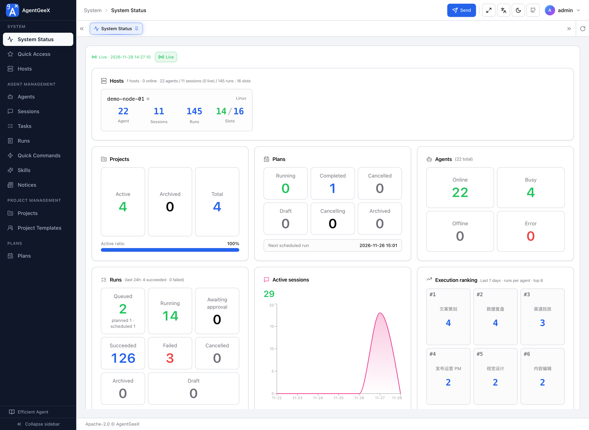
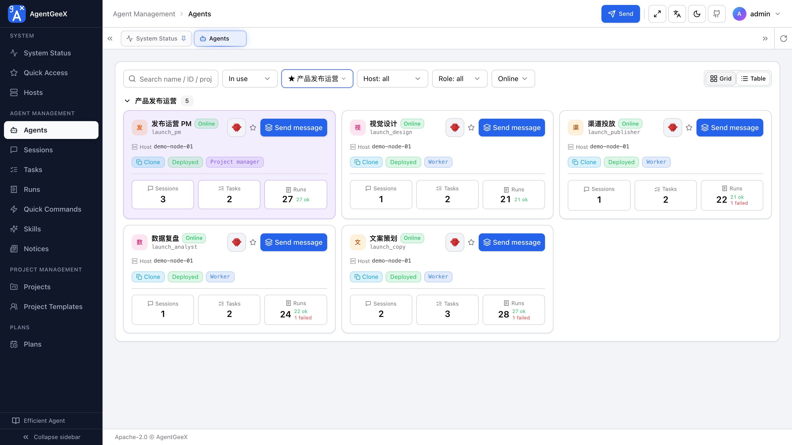
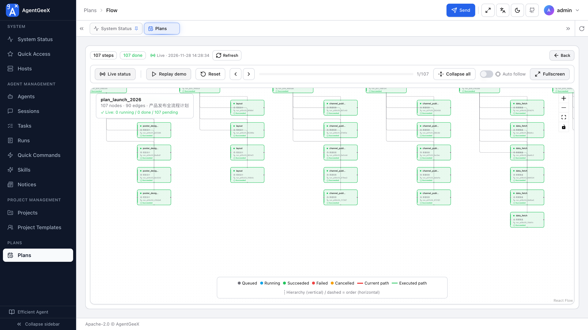
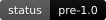
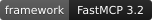
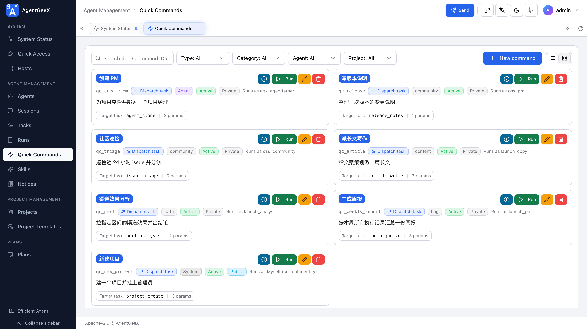

<!-- English (GitHub) primary. Chinese version: README.zh-CN.md -->

# AgentGeeX

**Turn the agent runtimes you already run into a team instead of a crowd.**

*One person. An agent team.*

[English](README.md) · [简体中文](README.zh-CN.md)

> **Repository**: [GitHub](https://github.com/agentgeex/agentgeex_core) (primary) · [Gitee](https://gitee.com/agentgeex/agentgeex_core) (read-only mirror). Issues and pull requests are handled on GitHub.

<p align="center">
  
</p>

<p align="center">
  
  
</p>

AgentGeeX sits between the agent runtimes you already operate — OpenClaw, Claude Code, any MCP
client — and the work you actually want done. It does not call models and it does not write
prompts. It gives the agents you already have three things they are missing: **an identity that
survives a restart, a piece of work that is defined before it runs, and a record of what actually
happened** — self-hosted, on your own MySQL and Redis.

**You need this** if two or more agents should hand work to each other and you would rather not
reconstruct who did what from chat logs. **You do not need this** if one agent does one thing well —
run that runtime directly.

→ **Shortest path in:** [Install](#install) (one command, two config files) ·
[15-minute walkthrough](#15-minutes-get-your-first-agent-through-a-piece-of-work) ·
[Concepts](docs/concepts/)

<p align="center">
  
  
  
  
</p>

<details>
<summary>Stack and compatibility — Python 3.12 · uv · MCP 1.x · FastMCP 3.2 · MySQL 8.0 · Redis 6.2+ · OpenClaw · Claude Code · DSH · Node.js 22.22.3+ · Codex (POC) · 96 MCP tools · 4 system agents</summary>

<p align="center">
  
  
</p>
<p align="center">
  
  
  
  
  
  
</p>
<p align="center">
  
  
  
  
  
</p>

</details>

---

## What AgentGeeX is

AgentGeeX is **not** another agent framework. It does not call models, write prompts, or pick models for you.

It is a **self-hosted orchestration control plane** that sits on top of the agent runtimes **you already have running**. You have one OpenClaw instance and it works well; you have three and they know nothing about each other. AgentGeeX supplies the layer that is missing between them — persistent identity, task templates, plans with dependencies, watchdog supervision, and a complete audit trail — all on your own machines, all reached through MCP.

## How it probably looks today

Three agents, each perfectly capable on its own. But none of them can pick up another's work, none knows what the others already did, a restart wipes the context, and when something goes wrong the only record is a chat log.

The model is not the problem. The missing piece is **orchestration**.

## What you get

| Capability | Consequence |
|---|---|
| **Persistent identity** | An agent still knows who it is and how far it got after a restart |
| **Task template / execution instance separation** | Define "this piece of work" first, then assign people and machines; the same work can run repeatedly and be compared |
| **Plans with dependencies** | Multi-step work advances on its own instead of someone chasing it |
| **Watchdog** | Timeouts trigger wakes and alerts; you do not have to remember |
| **Audit trail** | Who changed what and when is all in the database — queryable, reproducible |

## Architecture: three layers, one job each

```
Agent runtime: OpenClaw · Claude Code · any MCP client
          │
          │  MCP — the only interface, 96 tools
          ▼
   AgentGeeX kernel
          │
          ├─ MySQL   single source of truth: projects / agents / hosts / task definitions / executions / notices
          │
          └─ Redis   speed only: task queues / heartbeats / distributed locks / cache
```

Scheduling is decentralised: agents may live on different networks and different hosts. Auditing is centralised: every action lands in the same database in real time. **Keeping those two apart is what stops the system from drifting out of control.**

## Supported runtimes

| Runtime | How it connects | Version we tested | Status |
|---|---|---|---|
| **OpenClaw** | WS session channel; tmux as the degraded path | 2026.8.35 | First-class, full capability (sessions / wakeups / receipts) |
| **Claude Code** | Standalone CLI channel (`claude --print`) | 2.1.318 | Supported |
| **DeepSeek Harness (DSH)** | Long-lived stdio JSON-RPC subprocess; HTTP legacy bridge still works | 0.2.1-rc.5 / 0.2.2 | Supported |
| **Codex** | — | 0.166.0 (verified as a POC) | Planned, **not in the kernel** |
| **Any MCP client** | Call the 96 tools directly (stdio / streamable-http) | — | Tool layer usable, no scheduling |

Integration **does not change one line of the other side's code**; everything goes through their public interfaces. The version column lists **combinations we actually ran**, not minimum requirements (the one exception is Node, see Requirements).

> Third-party product names and trademarks belong to their respective owners. This project is not affiliated with, or endorsed by, any of the projects above.

## Stack

Every row below is something the kernel **actually uses**, not what a scaffold ships with:

| Layer | Technology | Version | What it does |
|---|---|---|---|
| Language | **Python** | ≥3.12 | Kernel / MCP / daemons, all of it |
| Environment | **uv** | 0.10.x | Pin versions, build the venv; no hand-written requirements |
| Protocol | **MCP** (Model Context Protocol) | 1.x · streamable-http | The only interface between agents and the kernel |
| MCP framework | **FastMCP** | 3.2 | Registration and transport for the 96 tools |
| Persistence | **MySQL** | 8.0 | Single source of truth: projects / agents / hosts / task definitions / executions / notices |
| Speed layer | **Redis** | 6.2+ | Task queues / heartbeats / distributed locks / entity cache |
| DB drivers | **PyMySQL** · **redis-py** | 1.1 · 7.4 | Talk to the two stores above; no ORM |
| Daemons | **in-house daemon + watchdog** | — | Consume queues, deliver messages, wake and alert on timeout |
| Realtime channel | **WebSocket** | 16.0 | Sessions, wakeups and receipts with the agent runtimes |
| Runtime host | **Node.js** | 22.22.3+ | OpenClaw is a Node program and its `engines` field decides the Node version; pure worker nodes do not need it |
| Runtime | **OpenClaw** / Claude Code / DSH / any MCP client | — | The layer that does the actual work; not part of this project |

> Deliberately excluded: **ORM** (raw SQL, every statement visible), **message broker** (queues go straight into Redis rather than adding another process), **managed services** (self-hosted only).

## Requirements

| Item | Requirement |
|---|---|
| OS | macOS / Linux / Windows |
| Python | 3.12+ (managed by `uv`; do not install dependencies by hand) |
| MySQL | 8.x (required on the core node) |
| Redis | 6.2+ (required on the core node) |
| Node.js | Follows OpenClaw: `>=22.22.3 <23` or `>=24.15.0 <25` or `>=25.9.0` (taken from its own `engines`); optional on pure worker nodes |
| Machine | Reference: 2 cores / 4 GB runs the whole chain on one box; production sizing depends on the number of agents |

Prepare MySQL and Redis yourself; this project does not install them for you.

## Install

The installer never asks for passwords. Before you start, prepare two files (both under `~/.agx/`):

**`~/.agx/agx_config.json`** — this machine's identity and addresses. At minimum these three items:

```json
{
  "host_id": "machine identifier (globally unique, e.g. test_host_mac)",
  "network_id": "lan_001",
  "gateways": [{ "host_id": "same as host_id", "ws_url": "ws://127.0.0.1:18789" }]
}
```

**`~/.agx/agx_creds.env`** — database credentials, `chmod 600`, deliberately kept out of the config file and out of git:

```
AGX_DB_HOST=127.0.0.1
AGX_DB_PORT=3306
AGX_DB_USER=...
AGX_DB_PASS=...
AGX_DB_NAME=agentgeex
AGX_REDIS_HOST=127.0.0.1
AGX_REDIS_PORT=6379
AGX_REDIS_DB=0
AGX_REDIS_PASSWORD=...
```

Then:

```bash
git clone https://github.com/agentgeex/agentgeex_core.git
cd agentgeex
./agx.sh
```

The install runs in ten phases, in this order:

```
Phase 1    config confirmation
Phase 2    dependency check
Phase 3    work directory setup
Phase 4    agent registration
Phase 5    file sync and dependency rollout
Phase 6    database initialisation
Phase 6.5  schema sync
Phase 7    local machine initialisation
Phase 7.5  Redis cache rebuild
Phase 8    cleanup and start
```

When it finishes there are four system agents on the machine: `agx_core` (scheduling), `agx_host` (host management), `agx_agentfather` (creates agents), `agx_projectmother` (creates projects).

- Non-interactive install: `./agx.sh --default` (skips confirmation; the two files above are still required)
- Worker node only (no database, no daemons): `./agx.sh --host`
- See what it would do: `./agx.sh --dry-run`
- Custom work directory: `--workdir DIR` (default `~/.agx`)

## Connect your agent runtime

AgentGeeX merges the three MCP services into a single-process gateway (so every session does not have to spawn its own set):

```bash
./mcp.sh start          # default 127.0.0.1:31890
./mcp.sh check          # handshake once against each of the three endpoints
```

```
[gateway] selfcheck OK   http://127.0.0.1:31890/agentgeex/mcp
```

Then register it in the OpenClaw config (`~/.openclaw/openclaw.json`):

```json
{
  "mcp": {
    "servers": {
      "agentgeex": { "transport": "streamable-http", "url": "http://127.0.0.1:31890/agentgeex/mcp" },
      "mysql-srv": { "transport": "streamable-http", "url": "http://127.0.0.1:31890/mysql/mcp" },
      "redis-srv": { "transport": "streamable-http", "url": "http://127.0.0.1:31890/redis/mcp" }
    }
  }
}
```

```
agentgeex    96 tools
mysql-srv     5 tools
redis-srv     7 tools
```

## The console: what it actually looks like

AgentGeeX speaks MCP. That is the right interface for an agent and a useless one for a person. The
web console is the human side of the same database: it reads through a small FastAPI BFF, never talks
to MySQL directly, and never becomes a second source of truth.

Everything below is live data from a real install -- 22 agents, 96 MCP tools, one host.

<p align="center">
  
</p>

Fourteen pages, four groups:

| Group | Pages | What it answers |
|---|---|---|
| System | System status · Quick access · Hosts | Is the whole thing healthy right now |
| Agent management | Agents · Sessions · Tasks · Runs · Quick commands · Skills · Notices | Who exists, what they did, what they can do |
| Project management | Projects · Project templates | Who belongs together and what they may touch |
| Plans | Plans | Which multi-step work is advancing on its own |

**Two things the console deliberately does not do.** It does not create agents through a form -- you
ask `agx_agentfather` in a message, because creating an agent is a deployment, not a data entry. And
it never lets the frontend touch the database: every write goes through an MCP tool, so a click from
the UI is audited exactly like a call from an agent.

📖 **[Console operations manual](webtools/docs/manual.md)** — all fourteen pages one by one, with
screenshots in English and Chinese, how to start it, how to sign in, how to run one task end to end,
and how to set up the speech-to-text service.

## 15 minutes: get your first agent through a piece of work

**Step 1 · Let it self-check**

Tell `agx_core`: "run `agx_check_services`"
→ it should report MySQL `healthy` and Redis `healthy`.

**Step 2 · Create a project**

Tell `agx_core`: "create a project called XX, short name xx"
→ you get a `project_id` back and one more row in `agx_project`.

**Step 3 · Build a team**

Tell `agx_core`: "this project needs one PM and one worker, both deployed to this machine"
→ it goes through `agx_agentfather` to clone and `agx_host` to deploy; both agents show up in the agent list.

**Step 4 · Wake them**

```bash
./agx.sh --wakeup
```

**Step 5 · Assign the first piece of work**

Tell that worker: "write a 300-word brief on XX, put the output in outputs"
→ it receives an `execution`, finishes with status `succeeded`, and the output lands in its own workspace.

At this point you have: a project, a team, and one auditable execution record.

## Who this is not for

Short version: if one agent does one thing, you do not need this layer. The three full boundaries:

- **You only need one agent doing one thing** → use OpenClaw or Codex directly; you do not need an orchestration layer
- **You want managed SaaS** → this project is self-hosted only; there is no cloud offering
- **You do not want to run MySQL/Redis** → the cost of installing them will exceed the benefit

## Where the docs and the code are

| What | Where |
|---|---|
| Architecture | [`docs/concepts/architecture.md`](docs/concepts/architecture.md) |
| MCP gateway (stdio → HTTP migration) | [`docs/concepts/mcp-gateway.md`](docs/concepts/mcp-gateway.md) |
| Host platforms and endpoints | [`docs/concepts/host-platforms.md`](docs/concepts/host-platforms.md) |
| Claude Code integration | [`docs/concepts/claude-code-compat.md`](docs/concepts/claude-code-compat.md) |
| Task protocol | [`docs/concepts/task-protocol.md`](docs/concepts/task-protocol.md) |
| Permission system | [`docs/concepts/permissions.md`](docs/concepts/permissions.md) |
| Project management | [`docs/internal/project-management.md`](docs/internal/project-management.md) |
| Agent layout and Git conventions | [`docs/development/repo-layout-and-git.md`](docs/development/repo-layout-and-git.md) |
| Task templates | [`tasks/`](tasks/) (the capability manual for each agent) |
| **Let an agent install it** (hand this to your agent) | [`docs/getting-started/install-with-agent.md`](docs/getting-started/install-with-agent.md) |
| **Console operations manual** (14 pages, screenshots) | [`webtools/docs/manual.md`](webtools/docs/manual.md) |
| **User guide** (concepts and workflow, 8 chapters) | [`docs/manual/README.md`](docs/manual/README.md) |
| Full documentation index | [`docs/README.md`](docs/README.md) |
| Environment probe | `python3 scripts/probe_env.py` |
| Schema consistency check | `python3 scripts/verify_schema.py` |
| Task list consistency check | `python3 scripts/verify_tasks.py` |
| Documentation link check | `python3 scripts/check_doc_links.py` |

## Project status

`v0.1.0`, pre-1.0. **Table schemas and MCP tool signatures will still change; there is no backward-compatibility guarantee.** This version is aimed at setting up your own environment and getting the chain to run; production use is not recommended yet.

## License and contributing

Released under the **[Apache License 2.0](LICENSE)**.

- ✅ Allowed: commercial use, closed-source modification, SaaS, redistribution (keep the copyright and licence notices, and `NOTICE` if present)
- ✅ Included: **an express patent grant** (with a patent-litigation termination clause)
- ❌ Not included: **trademark rights** — the "AgentGeeX" name and logo are not licensed by this licence

See [`NOTICE`](NOTICE) for the copyright statement.

**Security issues**: please do not open a public issue; contact the maintainers directly. See [`SECURITY.md`](SECURITY.md).

**Contributing**: see [`CONTRIBUTING.md`](CONTRIBUTING.md). Right now the most useful thing you can send is an issue describing your scenario and where you got stuck.
