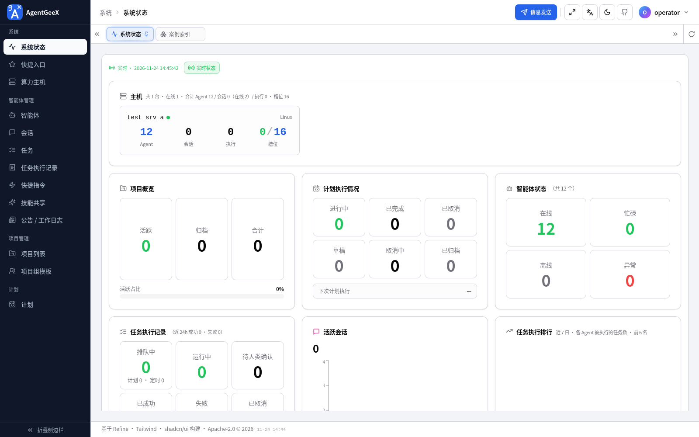
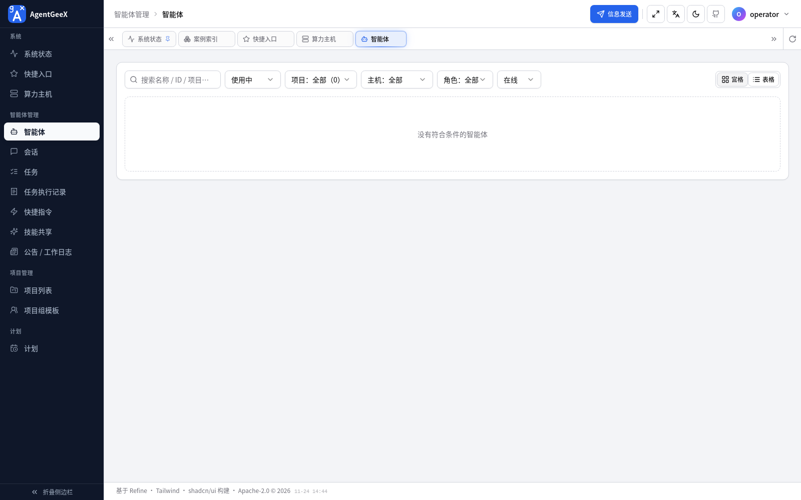
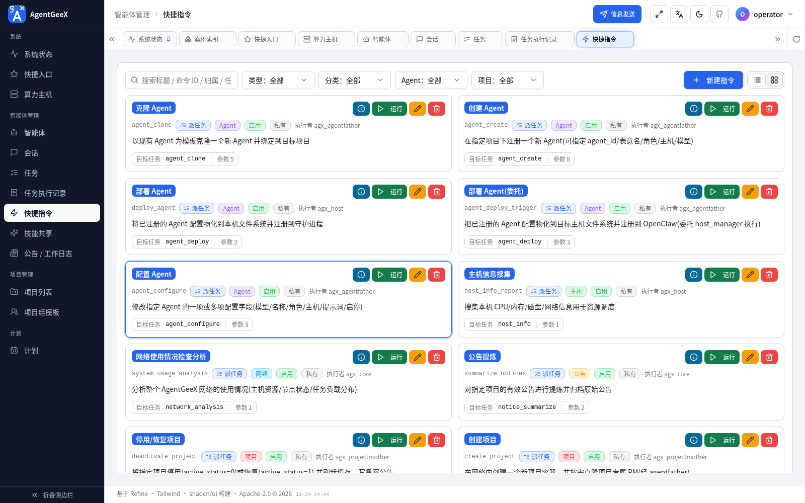

<!-- 中文版。英文版见 README.md（GitHub 主版本）。 -->

# AgentGeeX

**让已有的 Agent 运行时，从单打独斗变成一支队伍。**

简体中文 · [English](README.md)

> **仓库**：[GitHub](https://github.com/agentgeex/agentgeex_core)（主仓） · [Gitee](https://gitee.com/agentgeex/agentgeex_core)（只读镜像）。Issue 与 PR 统一在 GitHub 处理。

<p align="center">
  
  
  
  
  
  
</p>

<p align="center">
  
  
  
  
  
  
</p>

<p align="center">
  
  
  
  
  
</p>

---

## AgentGeeX 是什么

AgentGeeX **不是**又一个 Agent 框架，它不调用大模型、不写 prompt、不选模型。

它是一层**自托管的编排控制面**，作用在**你已经跑起来的** Agent 运行时之上：你本来有一个 OpenClaw，它很好用；你有三个，它们互相不认识。AgentGeeX 补齐的是它们之间缺的那一层——持久身份、任务模板、带依赖的计划、看门狗监督、完整审计链，全部跑在你自己的机器上，全部通过 MCP 接入。

## 你今天大概是这样

三个 Agent，各自都能干活。但谁也接不了谁的活，谁也不知道别人干过了什么，机器一重启上下文就没了，出了事只能翻聊天记录。

这不是模型不行，是**缺编排**。

## 它给你什么

| 能力 | 后果 |
|---|---|
| **持久身份** | Agent 重启后仍然知道自己是谁、干到哪一步 |
| **任务模板 / 执行实例分离** | 先定义"这件事"，再派人、派机器；同一件事可以重复跑、互相比较 |
| **带依赖的计划** | 多步任务自己往下走，不用人盯着催 |
| **看门狗** | 超时自动唤醒和告警，不是等你想起来 |
| **审计链** | 谁在什么时候改了什么，全在库里，可查可复现 |

## 架构：三层，各管一件事

```
Agent 运行时：OpenClaw · Claude Code · 任意 MCP 客户端
          │
          │  MCP —— 唯一接口，96 个工具
          ▼
   AgentGeeX 内核
          │
          ├─ MySQL   唯一真源：项目 / Agent / 主机 / 任务定义 / 执行实例 / 公告
          │
          └─ Redis   只负责快：任务队列 / 心跳 / 分布式锁 / 缓存
```

调度是去中心化的：Agent 可以分布在不同网络、不同主机。审计是中心化的：所有行为实时落到同一个库。**这两件事分开，系统才不会失控。**

## 支持的运行时

| 运行时 | 接入方式 | 实测版本 | 状态 |
|---|---|---|---|
| **OpenClaw** | WS 会话通道；tmux 降级路径 | 2026.8.35 | 一等公民，完整能力（会话 / 唤醒 / 回执） |
| **Claude Code** | 独立 CLI 通道（`claude --print`） | 2.1.318 | 支持 |
| **DeepSeek Harness（DSH）** | stdio JSON-RPC 长驻子进程；HTTP 旧桥兼容 | 0.2.1-rc.5 / 0.2.2 | 支持 |
| **Codex** | — | 0.166.0（POC 验过） | 规划中，**未进内核** |
| **任意 MCP 客户端** | 直接调 96 个工具（stdio / streamable-http） | — | 工具层可用，无调度能力 |

接入**不改对方一行代码**，全部走它们的公开接口。版本列是**我们实测跑通的组合**，不是最低要求（唯一例外是 Node，见环境要求）。

> 文中提及的第三方产品名称与商标归各自所有者所有。本项目与上述项目无隶属或背书关系。

## 技术栈

下表每一行都是内核**实际在用**的，不是“脚手架自带的”：

| 层 | 技术 | 版本 | 用来干什么 |
|---|---|---|---|
| 语言 | **Python** | ≥3.12 | 内核 / MCP / 守护进程全部 |
| 依赖环境 | **uv** | 0.10.x | 锁版本、建 venv，不用手写 requirements |
| 协议 | **MCP**（Model Context Protocol） | 1.x · streamable-http | Agent 与内核之间的唯一接口 |
| MCP 框架 | **FastMCP** | 3.2 | 96 个工具的注册与传输 |
| 持久化 | **MySQL** | 8.0 | 唯一真源：项目 / Agent / 主机 / 任务定义 / 执行实例 / 公告 |
| 速度层 | **Redis** | 6.2+ | 任务队列 / 心跳 / 分布式锁 / 实体缓存 |
| 数据库驱动 | **PyMySQL** · **redis-py** | 1.1 · 7.4 | 访问上面两个库，不引入 ORM |
| 守护进程 | **自研 daemon + watchdog** | — | 消费队列、投递消息、超时唤醒与告警 |
| 实时通道 | **WebSocket** | 16.0 | 与 Agent 运行时之间的会话、唤醒、回执 |
| 运行时宿主 | **Node.js** | 22.22.3+ | OpenClaw 是 Node 程序，Node 版本由它的 `engines` 决定；纯工作节点不需要 |
| 运行时 | **OpenClaw** / Claude Code / DSH / 任意 MCP 客户端 | — | 真正干活的那一层，不在本项目内 |

> 刻意不用：**ORM**（全裸 SQL，看得见每一句）、**消息中间件**（队列直接压 Redis，不多引入一个进程）、**托管服务**（只做自托管）。

## 环境要求

| 项 | 要求 |
|---|---|
| 系统 | macOS / Linux / Windows |
| Python | 3.12+（由 `uv` 管理，不用手动装依赖） |
| MySQL | 8.x（核心节点必需） |
| Redis | 6.2+（核心节点必需） |
| Node.js | 跟随 OpenClaw：`>=22.22.3 <23` 或 `>=24.15.0 <25` 或 `>=25.9.0`（取自它自己的 `engines`）；纯工作节点可省 |
| 机器 | 参考：单机 2 核 / 4 GB 可跑通链路；生产按 Agent 数量另算 |

MySQL 与 Redis 请预先准备好，本项目不代装。

## 安装

安装器自己不收集密码。开始之前先准备两个文件（都在 `~/.agx/` 下）：

**`~/.agx/agx_config.json`** —— 本机身份与地址。最少要有这三项：

```json
{
  "host_id": "本机标识（全局唯一，如 test_host_mac）",
  "network_id": "lan_001",
  "gateways": [{ "host_id": "同 host_id", "ws_url": "ws://127.0.0.1:18789" }]
}
```

**`~/.agx/agx_creds.env`** —— 数据库账号密码，`chmod 600`，不进配置文件也不进 git：

```
AGX_DB_HOST=127.0.0.1
AGX_DB_PORT=3306
AGX_DB_USER=...
AGX_DB_PASS=...
AGX_DB_NAME=agentgeex
AGX_REDIS_HOST=127.0.0.1
AGX_REDIS_PORT=6379
AGX_REDIS_DB=0
AGX_REDIS_PASSWORD=...
```

然后：

```bash
git clone https://github.com/agentgeex/agentgeex_core.git
cd agentgeex
./agx.sh
```

安装过程分十个阶段，你会依次看到：

```
Phase 1    配置确认
Phase 2    依赖检测
Phase 3    工作目录设置
Phase 4    注册 Agent
Phase 5    文件同步与依赖下发
Phase 6    数据库初始化
Phase 6.5  结构同步
Phase 7    本机初始化
Phase 7.5  Redis 缓存重建
Phase 8    清理与启动
```

装完后本机会有四个系统 Agent：`agx_core`（调度）、`agx_host`（主机管理）、`agx_agentfather`（建 Agent）、`agx_projectmother`（建项目）。

- 非交互安装：`./agx.sh --default`（跳过确认，配置仍需上面两个文件）
- 只装工作节点（不建库、不起守护进程）：`./agx.sh --host`
- 先看要做什么：`./agx.sh --dry-run`
- 自定义工作目录：`--workdir DIR`（默认 `~/.agx`）

## 接上你的 Agent 运行时

AgentGeeX 把三个 MCP 服务合成一个单进程网关（省掉每个会话各起一套进程的开销）：

```bash
./mcp.sh start          # 默认 127.0.0.1:31890
./mcp.sh check          # 三个端点各握手一次
```

```
[gateway] selfcheck OK   http://127.0.0.1:31890/agentgeex/mcp
```

然后在 OpenClaw 的配置里登记（`~/.openclaw/openclaw.json`）：

```json
{
  "mcp": {
    "servers": {
      "agentgeex": { "transport": "streamable-http", "url": "http://127.0.0.1:31890/agentgeex/mcp" },
      "mysql-srv": { "transport": "streamable-http", "url": "http://127.0.0.1:31890/mysql/mcp" },
      "redis-srv": { "transport": "streamable-http", "url": "http://127.0.0.1:31890/redis/mcp" }
    }
  }
}
```

```
agentgeex    96 工具
mysql-srv     5 工具
redis-srv     7 工具
```

## 控制台：它到底长什么样

AgentGeeX 讲 MCP。这对 Agent 是对接口，对人则基本无用。网页控制台是同一个数据库的**人这一侧**：
它通过一个小的 FastAPI BFF 读数据，不直接碰 MySQL，也不会成为第二个真源。

下面全部是一台真实安装里的活数据 —— 12 个智能体、96 个工具、1 台主机。

<p align="center">
  
  
</p>
<p align="center">
  
</p>

14 个页面，分四组：

| 分组 | 页面 | 回答什么 |
|---|---|---|
| 系统 | 系统状态 · 快捷入口 · 算力主机 | 现在整体健不健康 |
| Agent 管理 | 智能体 · 会话 · 任务 · 执行 · 快捷指令 · 技能 · 公告 | 谁在、干了什么、能干什么 |
| 项目管理 | 项目 · 项目组模板 | 谁和谁一组、能碰什么 |
| 计划 | 计划 | 哪件多步骤的活在自己往前走 |

**控制台有两件事是刻意不做的。** 它不提供"新建 Agent"的表单 —— 你在消息里让 `agx_agentfather`
去做，因为创建一个 Agent 是一次部署，不是填一张表。它也不让前端碰数据库：每一次写都走 MCP 工具，
所以界面上点一下，和 Agent 调一次，审的是同一本账。

📖 **[控制台操作手册](webtools/docs/manual.zh-CN.md)** —— 14 个页面逐页说明，配中英两套截图；
怎么启动、怎么登录、怎么把一件事从头跑完、语音识别服务怎么配。

## 15 分钟：让第一个 Agent 干完一件活

**第 1 步 · 让它自检**

对 `agx_core` 说：「跑一下 `agx_check_services`」
→ 应返回 MySQL `healthy`、Redis `healthy`。

**第 2 步 · 建一个项目**

对 `agx_core` 说：「建一个项目，名字叫 XX，简称 xx」
→ 返回 `project_id`，库里多一行 `agx_project`。

**第 3 步 · 建一支队伍**

对 `agx_core` 说：「这个项目要一个 PM 和一个 worker，都部署到本机」
→ 走 `agx_agentfather` 克隆 + `agx_host` 部署，两个 Agent 出现在 Agent 列表里。

**第 4 步 · 唤醒**

```bash
./agx.sh --wakeup
```

**第 5 步 · 派第一件活**

对那个 worker 说：「写一份关于 XX 的调研，300 字，产出放进 outputs」
→ 它会拿到一条 `execution`，跑完状态变成 `succeeded`，产出落在它自己的 workspace 里。

到这里，你已经有了：一个项目、一支队伍、一条可审计的执行记录。

## 它不适合谁

- **只需要一个 Agent 干一件事** → 直接用 OpenClaw 或 Codex，不用上编排层
- **要的是托管 SaaS** → 本项目只做自托管，不提供云服务
- **不想维护 MySQL/Redis** → 装它的成本会高于用它

## 文档与代码在哪

| 内容 | 位置 |
|---|---|
| 系统架构说明 | [`docs/concepts/architecture.md`](docs/concepts/architecture.md) |
| MCP 网关（stdio → HTTP 迁移） | [`docs/concepts/mcp-gateway.md`](docs/concepts/mcp-gateway.md) |
| 主机平台与接入地址 | [`docs/concepts/host-platforms.md`](docs/concepts/host-platforms.md) |
| Claude Code 接入 | [`docs/concepts/claude-code-compat.md`](docs/concepts/claude-code-compat.md) |
| 任务协议 | [`docs/concepts/task-protocol.md`](docs/concepts/task-protocol.md) |
| 权限系统 | [`docs/concepts/permissions.md`](docs/concepts/permissions.md) |
| 项目管理 | [`docs/internal/project-management.md`](docs/internal/project-management.md) |
| Agent 目录与 Git 布局 | [`docs/development/repo-layout-and-git.md`](docs/development/repo-layout-and-git.md) |
| 任务模板 | [`tasks/`](tasks/)（每个 Agent 的能力说明书） |
| **控制台操作手册**（14 页，配中英截图） | [`webtools/docs/manual.zh-CN.md`](webtools/docs/manual.zh-CN.md) |
| **使用手册**（概念与流程，8 章） | [`docs/manual/README.md`](docs/manual/README.md) |
| 文档总索引 | [`docs/README.md`](docs/README.md) |
| **让 Agent 自己装**（交给你的 Agent 执行） | [`docs/getting-started/install-with-agent.md`](docs/getting-started/install-with-agent.md) |
| 环境探测 | `python3 scripts/probe_env.py` |
| 库结构一致性校验 | `python3 scripts/verify_schema.py` |
| 任务清单一致性校验 | `python3 scripts/verify_tasks.py` |

## 项目状态

`v0.1.0`，pre-1.0。**表结构与 MCP 工具签名仍会变，不保证向后兼容。** 当前版本面向自己人搭环境、跑通链路，不建议用于生产。

## 许可证与协作

本项目采用 **[Apache License 2.0](LICENSE)**。

- ✅ 可以：商用、闭源修改、SaaS、再分发（保留版权与许可证声明，有 `NOTICE` 则一并保留）
- ✅ 附带：**明示专利授权**（含专利反诉终止条款）
- ❌ 不含：**商标授权** —— “AgentGeeX” 名称与标识不在本许可证授权范围内

版权声明见 [`NOTICE`](NOTICE)。

**安全问题**：请勿开公开 issue，直接联系维护者，见 [`SECURITY.md`](SECURITY.md)（[中文](SECURITY.zh-CN.md)）。

**贡献**：见 [`CONTRIBUTING.md`](CONTRIBUTING.md)（[中文](CONTRIBUTING.zh-CN.md)）；现阶段最有用的是 issue，说明你的使用场景与卡点。
