# AgentGeeX Console · Operations Manual

> This manual is about **using the web interface**: how to start it, how to sign in, what each
> page does, and how to run one piece of work end to end.
> Installing AgentGeeX itself (kernel, database, daemons) is a different document --
> see [`../../docs/getting-started/install-with-agent.md`](../../docs/getting-started/install-with-agent.md).
>
> Every screenshot here comes from a real installed test machine: host `test_srv_a`, network
> `lan_test`, one auto-created `system` project, 12 agents. Your names will differ; the screens
> will look the same.

---

## Contents

1. [What this is](#1-what-this-is)
2. [Before you start](#2-before-you-start)
3. [Starting up](#3-starting-up)
4. [Signing in](#4-signing-in)
5. [Interface map](#5-interface-map)
6. [Page by page](#6-page-by-page)
7. [One full walkthrough: dispatch a task](#7-one-full-walkthrough-dispatch-a-task)
8. [Troubleshooting](#8-troubleshooting)
9. [Stopping and reinstalling](#9-stopping-and-reinstalling)

---

## 1. What this is

The AgentGeeX console is a **web UI for people**.

Four layers sit underneath it:

```
Browser (what you see)
   │  REST + JWT
   ▼
BFF (FastAPI, port 8090)        ← auth, aggregation, field trimming, rate limiting
   │  MCP protocol (streamable-http)
   ▼
MCP gateway (port 31890)        ← the kernel's only entry point, 96 tools
   │
   ▼
MySQL + Redis                   ← single source of truth + cache
```

**Why the BFF layer exists**: the kernel is built for agents (MCP, 96 tools, raw wide rows).
A person wants "12 agents, 1 host, 7 tasks today". The BFF turns wide rows into cards, hides
internal fields, and keeps authorisation on the server. **The frontend never talks to MySQL.**

One sentence: **every number you see in the UI was fetched from the kernel through MCP.**

---

## 2. Before you start

Three things must be running:

| Component | Notes | How to check |
|---|---|---|
| MCP gateway `:31890` | the kernel's only entry point | `curl -s http://127.0.0.1:31890/agentgeex/mcp` responds |
| MySQL + Redis | the kernel's data layer | if the kernel starts, these are fine |
| Node ≥ 18 | frontend build and dev server | `node -v` |

If AgentGeeX itself is installed per the install guide (`~/.agx` exists, `daemon.sh status`
reports running), that is enough.

> **First run on a fresh machine** needs the frontend dependencies once:
>
> ```bash
> cd ~/.agx/webtools/client && npm install
> ```
>
> On mainland networks set a mirror first: `export npm_config_registry=https://registry.npmmirror.com`

---

## 3. Starting up

One command brings up all three layers:

```bash
cd ~/.agx/webtools
./start.sh start
```

Success looks like this:

```
🚀 启动 Win3 商业控制台（三层）
✅ MCP 网关已在运行 (:31890)
✅ BFF 就绪 (:8090)   日志: /tmp/win3_bff.log
✅ 前端就绪 (:5190)   日志: /tmp/win3_client.log
✅ 全部就绪 → 打开 http://localhost:5190/
```

**Which log to read when a layer breaks:**

| Layer | Port | Log | Symptom when down |
|---|---|---|---|
| MCP gateway | 31890 | `~/.agx/logs/agx-mcp-gateway.out` | every list is empty; `/readyz` shows `mcp_sse: false` |
| BFF | 8090 | `/tmp/win3_bff.log` | pages load but data never arrives; browser console full of 502s |
| Frontend | 5190 | `/tmp/win3_client.log` | the page will not open at all |

**Common subcommands:**

```bash
./start.sh status     # three-layer status and ports
./start.sh restart    # restart BFF and frontend (leaves MCP alone)
./start.sh stop       # stop BFF and frontend (MCP is PM2's job; this script will not touch it)
./start.sh logs       # follow logs
./start.sh check      # end-to-end health check
```

**Changing ports** (when something already occupies the defaults):

```bash
BFF_PORT=8190 CLIENT_PORT=5290 ./start.sh start
```

> ⚠️ **`start.sh` must run in a shell that has `node` on PATH.** Launch it from systemd, cron,
> or a non-interactive ssh session and `npm` may be missing -- the frontend layer then fails
> with `nohup: 无法运行命令 'npm'` (cannot run npm).
> Fix: prepend the node directory, e.g. `export PATH=/path/to/node/bin:$PATH`.

---

## 4. Signing in

Opening `http://localhost:5190/` shows the sign-in page first:

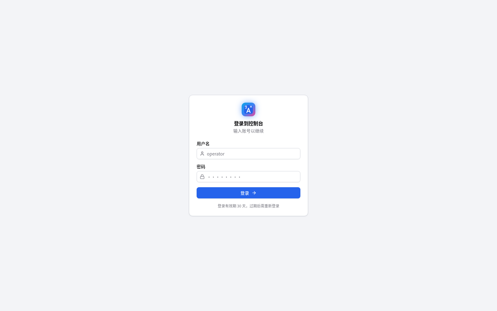

> ⚠️ **Sign-in is currently a demo-grade implementation**: `authenticate()` in
> `server/app/auth.py` is a placeholder -- **any non-empty username and password are accepted**.
> Its only job is to issue a JWT and record you as the **audit subject** (who clicked).
> Wiring a real user source (a user table, or your corporate IdP) is a must-do before release;
> the code comments mark exactly where to plug it in.

Two concepts that are easy to confuse (this is the one place the product design invites you to
get backwards):

| Concept | What it is | Where you choose it |
|---|---|---|
| **Login account** | a **person** (operator) | at sign-in |
| **Sender agent** | which agent this action speaks **as** | per action, in the dialog |

After signing in, the top-right corner shows the name you signed in with.

---

## 5. Interface map

You land on **System status**. The left rail has 14 entries in four groups:

| Group | Menu | Purpose |
|---|---|---|
| **System** | System status | the whole picture at a glance: hosts, projects, plans, agents, tasks, sessions |
| | Quick access | your starred projects / agents / sessions / plans |
| | Compute hosts | the machine inventory |
| **Agent management** | Agents | every agent; dispatch work, read its counters |
| | Sessions | agent conversations, with context-watermark |
| | Tasks | the task template catalogue (what an agent *can* do) |
| | Executions | every real run: who sent it to whom, how long, did it work |
| | Quick commands | pre-built commands -- fill a few parameters and send |
| | Shared skills | the global skill library (distilled "how to") |
| | Notices / work logs | announcements and logs written by agents |
| **Project management** | Projects | projects and their members |
| | Project groups | reusable team templates |
| **Plans** | Plans | multi-step plans and their progress |

Persistent controls along the top:

- **Send message** (blue button, top right): global dispatch, available on every page
- **Tab bar**: pages you opened stay as tabs
- **Fullscreen / theme (light-dark) / language (zh-en) / lock screen / user menu**

---

## 6. Page by page

### 6.1 System status

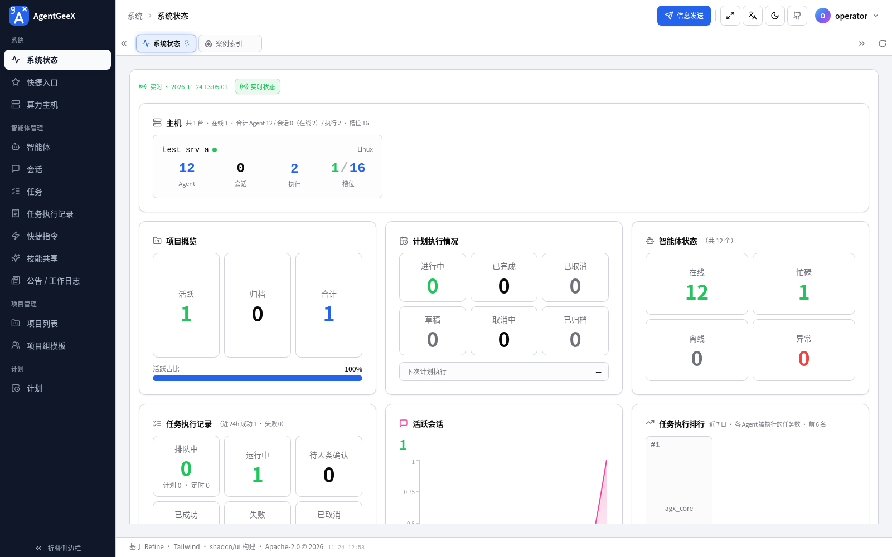

Answers "what shape is my system in right now" on one screen.

- **Hosts**: how many, how many online, total agents / sessions / executions / slots. Each
  card names the host (`test_srv_a` and friends) and its OS.
- **Project overview**: active / archived / total, plus an active-share bar.
- **Plan execution**: running / completed / cancelled / draft / cancelling / archived, and the
  next scheduled plan.
- **Agent status**: online / busy / offline / error.
- **Executions (last 24h)**: queued (scheduled / timed) / running / awaiting human confirm /
  succeeded / failed / cancelled.
- **Active sessions**: how many conversations are live.
- **Execution ranking (last 7 days)**: top 6 agents by task count.

> The small "实时" (live) badge in the top right means the page refreshes on a timer -- no F5 needed.

### 6.2 Quick access

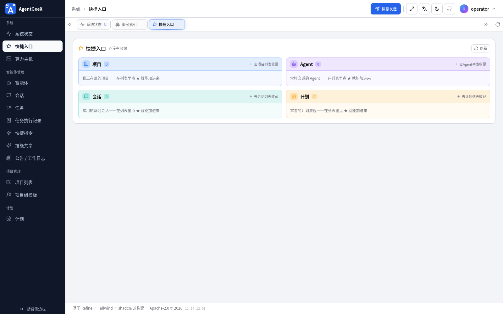

Four buckets: projects / agents / sessions / plans.

The whole usage is one sentence: **go to the list page, click the ★ on a row, and it shows up
here.** Each bucket's "go to the … list" link jumps straight there.

### 6.3 Compute hosts

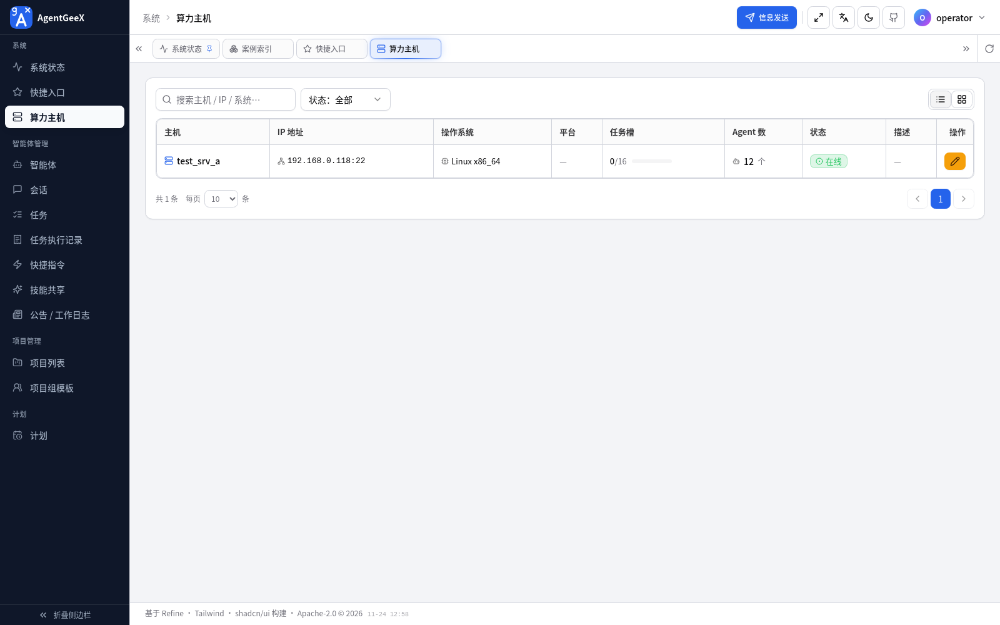

The machine inventory, from the kernel's `agx_host_inventory`.

Each card/row carries: host name, alias, IP, SSH port, OS, slot limit, current occupancy,
online state, last heartbeat, and how many agents live on it.

Toggle between **card view and table view** (top right); click the pencil to edit alias, IP,
SSH port, or slot limit.

### 6.4 Agents

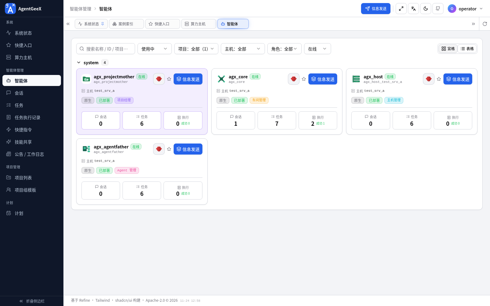

Every agent, grouped by project (the shot shows the four deployed system agents under `system`).

Filters: search / in-use / project / host / role / online state. Top right switches between
**dense grid and table**.

Each card carries:

- Name plus an **online** badge (green dot)
- Tags: `原生` (built-in), `已部署` (deployed to disk), and the role (project manager / workshop
  manager / host manager / agent manager / worker…)
- Three counters: **sessions / tasks / executions** (tasks = how many kinds of work it can do;
  executions = how many times it actually ran)
- **Send message** -- dispatch work to it
- ★ favourite, 🕐 history

> Template agents (workers not deployed yet) are hidden by the "in use" filter. To see them all,
> switch that filter to "all".

### 6.5 Sessions

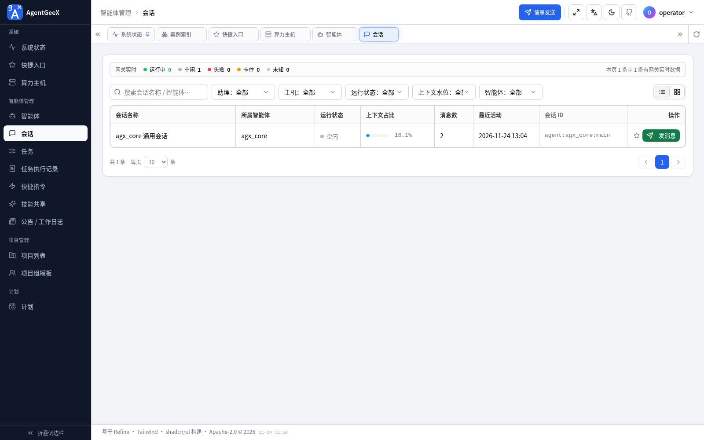

Agent conversations. The strip on top is live: **running / idle / failed / stuck / unknown**.

Per row: session name, owning agent, run state, **context share** (the most useful column --
past roughly 80% it is time to compact), message count, last activity, session ID.

The "send" action at the end of a row talks directly inside that session.

> Context share is colour-coded: blue while low, red as it fills. **When you see red, clear it**,
> or that agent's next turn may fail outright on context size.

### 6.6 Tasks

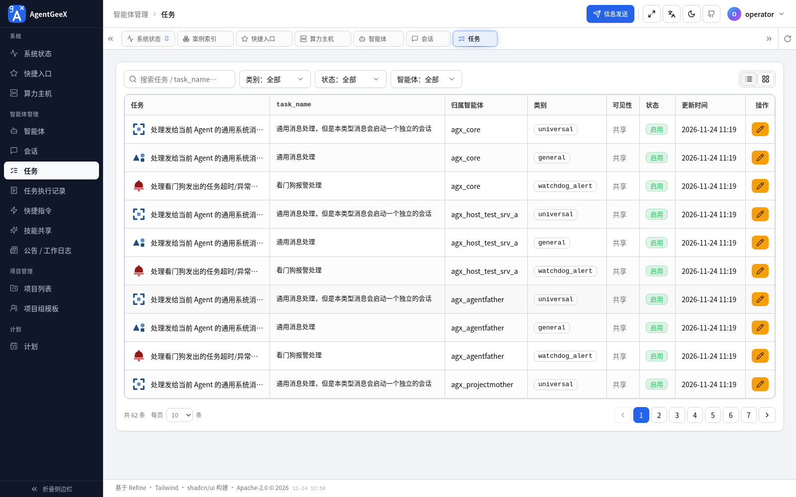

The **task template catalogue** -- a list of what an agent *can* do, not a run history.

Columns: task (description) / `task_name` (stable identifier) / owning agent / category
(`universal` / `general` / `watchdog_alert` / …) / visibility (shared / private) / state
(enabled / disabled) / updated / edit.

Filters: search / category / state / agent.

> Why does the same name repeat? Because templates are **per agent** -- every agent owns one
> `universal` row. That is where the 62 rows in the screenshot come from.

### 6.7 Executions

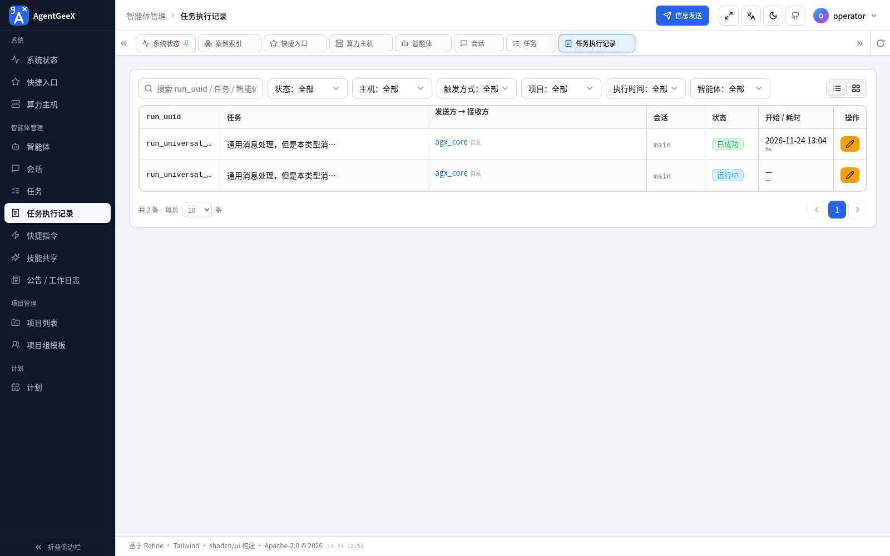

**Every real run** lands here. This is the first place to look when something goes wrong.

Columns: `run_uuid` / task / **sender → receiver** / session / state / started·duration / actions.

Filters are thorough: run_uuid, state, host, **trigger** (manual / plan / wake-up…), project,
time window, agent.

Click the pencil to expand: full instruction, result, SUMMARY, and the event timeline (when it
was dispatched, when it was woken, when it was acknowledged).

> The two rows above are the demo run from section 7: one `已成功 65s`, one still `运行中`.

### 6.8 Quick commands

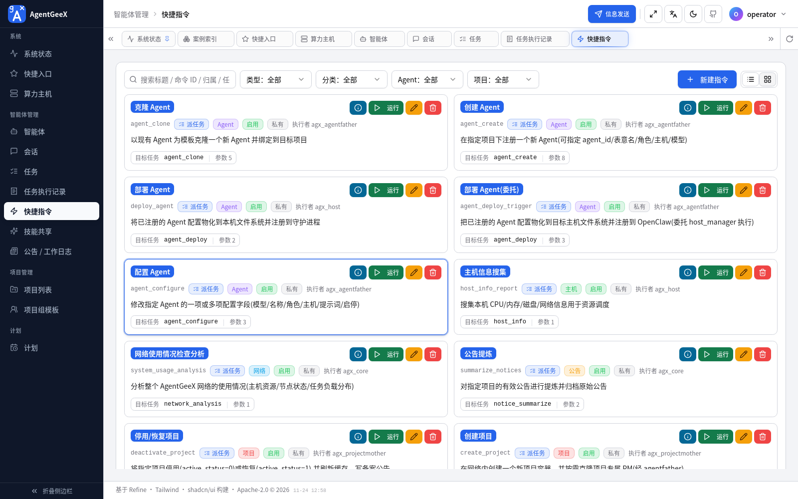

Frequently used operations as cards -- **fill a few parameters and send**, instead of typing a
long instruction every time.

Each card: name, logical ID, type tag (dispatch / agent / host / network / notice / project),
enabled state, visibility, **executor** (which agent performs it), and parameter count.

Buttons: ▶ run / ✏ edit / 🗑 delete. Top right: "+ new command".

Typical contents: clone an agent, create an agent, deploy an agent, configure an agent, collect
host info, network usage analysis, notice summarisation, create a project, deactivate a project…

### 6.9 Shared skills

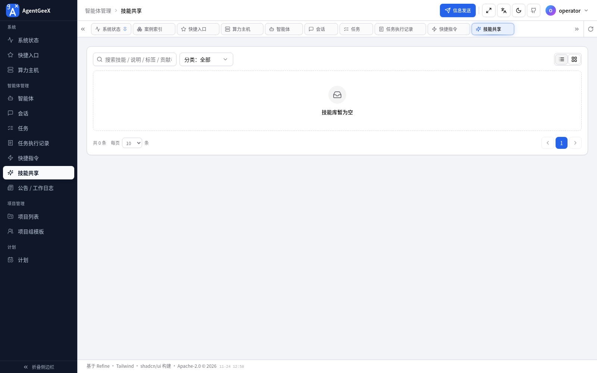

The global skill library. A skill is **a reusable, followable "how to"** (commands, pitfalls,
examples). The split from notices is deliberate:

| | What goes here |
|---|---|
| **Shared skills** | "how to get around this pitfall" -- readable and actionable |
| **Notices** | "what I did today" -- a record that something happened |

Search covers name / description / tags / contributor; filter by category. A fresh install is
empty here; it becomes valuable as the system is used (popular skills rise to the top).

### 6.10 Notices / work logs

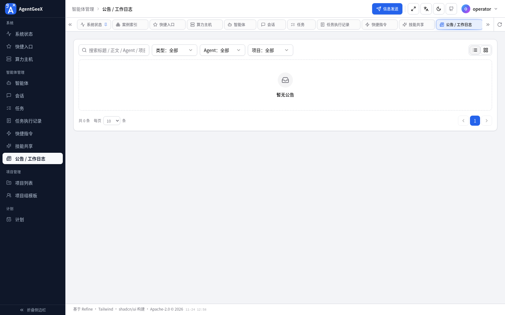

What agents wrote down: work logs, decisions, pitfalls, handoffs, configuration changes.
Filterable by type, visibility, project, agent, and originating task.

### 6.11 Projects

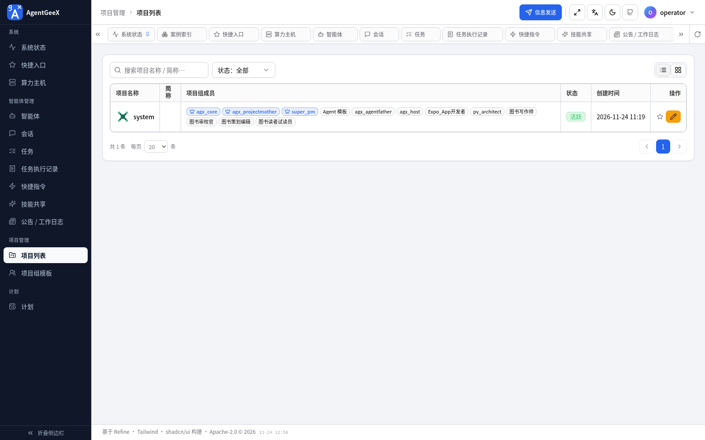

A project is the container for tasks, agents, and compute. Each row: project name, abbreviation,
**members** (a row of tags -- instantly see who is on it), state, created at.

A fresh install has only `system`, holding the 12 system-level agents (`agx_core` /
`agx_agentfather` / `agx_projectmother` / `agx_host_<your host>` / `super_pm` / the worker templates).

### 6.12 Project groups

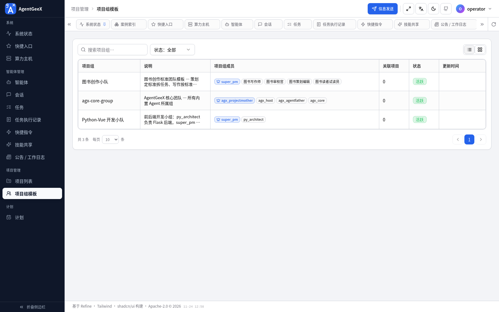

Reusable team templates: pack a set of agents together; bind the group to a new project and the
whole roster is cloned in one go.

Columns: group / description / members / bound projects / state / updated.

Three ship by default: `agx-core-group`, `Python-Vue 开发小队`, `图书创作小队`.

### 6.13 Plans

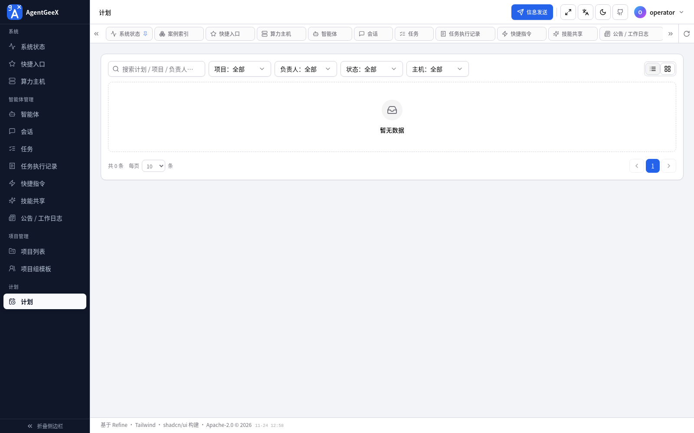

Multi-step plans and their progress. Filters: plan / owner / state / host.

Open one to see each step's state, its predecessor dependency, and whether it runs serially or
in parallel (fan-out / fan-in).

> Empty is normal -- a fresh install has not run a plan yet. `plan_generate_and_deploy` in Quick
> commands generates the first one.

---

## 7. One full walkthrough: dispatch a task

This is the most common path. Do it once and the whole system makes sense.

### Step 1 — pick the agent

Go to **Agents** and click **Send message** on the target card (or use the global
"Send message" button at top right).

### Step 2 — choose a template, write the instruction

The dialog wants three things:

| Field | What to put |
|---|---|
| Receiving session | the main session is fine (`agent:<name>:main`) |
| Task template | which kind of work. For one-off jobs choose `universal` |
| Instruction | plain language, what you want it to do |

One rule for instructions: **say what output you want, and what not to do.** For example:

```
Report this machine's CPU core count and total memory in one sentence. Do nothing else.
```

### Step 3 — watch it run

The instant you dispatch, **Executions** shows a row in `运行中` (running):


The state changes on its own: `运行中` → `已成功` (succeeded), or `失败` (failed).
The successful row above took 65 seconds.

### Step 4 — read the result

Click the pencil on that row to see the full instruction, the executor's SUMMARY, and the event
timeline.

Example result:

> CPU 4 cores, total memory 8016384 kB (about 7.6 GiB / 8 GB).

### Step 5 — look at the session

Back on **Sessions**, that agent now has a conversation where there was none, holding your two
messages and the **context share**:


---

## 8. Troubleshooting

### The page opens but every list is empty

99% of the time the BFF cannot read kernel data. Check in this order:

1. **`/readyz`**: `curl -s http://127.0.0.1:8090/readyz`
   A healthy answer looks like:
   ```json
   {"status":"ok","kernel":{"mcp_sse":true,"tool_count":96,"mysql":true,"redis":true}}
   ```
   `mcp_sse: false` → the MCP gateway is unreachable; go to step 2.
2. **MCP gateway**: does `curl -s http://127.0.0.1:31890/agentgeex/mcp` answer? If not,
   `./mcp.sh start`.
3. **`network_id` mismatch**: the classic one. Early BFF builds hard-coded the network as
   `lan_001`; if your `agx_config.json` says anything else, every `WHERE network_id = ?` matches
   nothing -- all lists empty while System status still looks fine (that page uses a different
   query). Fixed to read the config; an old build shows exactly this symptom.

### `/readyz` hangs and the log repeats `mcp session lost ... cannot import name 'streamablehttp_client'`

The `mcp` Python package renamed `streamablehttp_client` to `streamable_http_client` in 1.28,
so the old BFF import fails, MCP never connects, and `/readyz` hangs.

Fixed (both names accepted). If your build still reports it, update the code, or pin `mcp` to 1.27.0.

### A dispatched task stays "running" with an empty `started_at`

It was sent but the other side never started. Read `~/.agx/logs/ws_client.log`:

- `no such table: session_key_contract` → the openclaw state DB schema is off. Run
  `openclaw doctor --fix`, then restart the gateway.
- `会话不存在，自动创建` (session missing, creating) and then nothing → that agent is not
  registered/deployed in openclaw.
- Nothing at all → the daemon is not running. `~/.agx/daemon.sh status`.

### The frontend fails with `nohup: 无法运行命令 'npm'`

No node on PATH in a non-interactive shell. `export PATH=<your node bin>:$PATH` first, then re-run
`./start.sh start`.

### Opening it from another machine: page loads, no data

The frontend hard-codes its API base to `http://127.0.0.1:8090`. When you browse
`http://<server-ip>:5190` from **your own laptop**, the browser tries to reach port 8090 on
*your* machine, which is not there.

Two ways out:
- Start the frontend with an explicit base:
  `VITE_API_URL=http://<server-ip>:8090/v1 npm run dev`
- Or just view it on the server itself (local browser or remote desktop).

---

## 9. Stopping and reinstalling

```bash
cd ~/.agx/webtools
./start.sh stop            # stop BFF + frontend (MCP belongs to PM2; this script leaves it alone)
pm2 stop agx-mcp-gateway   # only when you really mean to stop MCP
```

**Full reinstall** (start from scratch):

```bash
cd <source dir>
python3 install.py --uninstall   # removes agents and clears the database
```

⚠️ **Measured caveat**: today `--uninstall` only removes the agent records from the gateway.
It does **not** delete `~/.openclaw/agents/<id>/`, and it will not proceed to clear the install
directory on its own (it asks for confirmation). Before reinstalling, do one extra step:

```bash
rm -rf ~/.openclaw/agents/agx_*      # leftover directories
```

Otherwise `install.py` will **reuse** the previous agent IDs found in the gateway -- and you will
see an old machine name appear on the new machine.

> One more thing to remember: when **a second instance** lives on the same machine (a different
> `--workdir`), the config file must be passed explicitly or the installer reads the default one:
>
> ```bash
> AGX_CONFIG_PATH=~/.agx_demo/agx_config.json \
> AGX_CREDS_ENV=~/.agx_demo/agx_creds.env \
> python3 install.py --core --workdir ~/.agx_demo
> ```

---

## Appendix: what this UI is built from

| Layer | Technology |
|---|---|
| Frontend | React + Refine + Tailwind + shadcn/ui, built by Vite, bilingual zh/en |
| BFF | FastAPI + uvicorn; JWT (HS256, a dependency-free implementation) |
| Kernel channel | MCP over streamable-http |
| Data | MySQL (source of truth) + Redis (cache) |

Every list on screen maps to one `GET /v1/<resource>` on the BFF. Each request carries the
signed-in user's JWT; the BFF validates it, then fetches from the kernel under a fixed identity
(`agx_core`).

---

*License: Apache-2.0. All screenshots come from a real test install and contain no production host names.*
