# AgentGeeX 控制台 · 操作手册

> 这份手册讲**怎么用界面**：怎么启动、怎么登录、每个页面是干什么的、怎么把一件事从头跑完。
> 安装 AgentGeeX 本体（内核、数据库、守护进程）不在这里，看 [`../docs/getting-started/install-with-agent.md`](../../docs/getting-started/install-with-agent.md)。
>
> 本手册配中英两套截图（界面右上角可切语言）。所有截图都来自一台真实安装的测试机：主机名 `test_srv_a`、网络 `lan_test`、一个自动创建的 `system` 项目、12 个智能体。你装出来的名字不同，但页面长得一样。

---

## 目录

1. [这是什么](#1-这是什么)
2. [开始之前](#2-开始之前)
3. [启动](#3-启动)
4. [登录](#4-登录)
5. [界面地图](#5-界面地图)
6. [逐页说明](#6-逐页说明)
7. [走一遍完整流程：派一个任务](#7-走一遍完整流程派一个任务)
8. [语音输入（语音转文字）](#8-语音输入语音转文字)
9. [常见问题](#9-常见问题)
10. [停止与重装](#10-停止与重装)

---

## 1. 这是什么

AgentGeeX 控制台是一个**给人用的网页**。

它下面有四层，从上到下：

```
浏览器（你看到的界面）
   │  REST + JWT
   ▼
BFF（FastAPI，端口 8090）      ← 鉴权、聚合、裁剪字段、限流
   │  MCP 协议（streamable-http）
   ▼
MCP 网关（端口 31890）         ← 内核唯一入口，96 个工具
   │
   ▼
MySQL + Redis                 ← 唯一真源 + 缓存
```

**为什么要中间那层 BFF**：内核是给 Agent 用的（MCP 协议、96 个工具、返回原始宽表）。人要看的是"12 个智能体、1 台主机、今天跑了 7 个任务"。BFF 负责把宽表裁成卡片、把内部字段挡住、把权限收在服务端。**前端永远不对着 MySQL 说话。**

一句话：**界面上能看到的每个数字，都是 BFF 通过 MCP 问内核要来的。**

---

## 2. 开始之前

你需要三样东西在跑：

| 组件 | 说明 | 怎么确认 |
|---|---|---|
| MCP 网关 `:31890` | 内核唯一入口 | `curl -s http://127.0.0.1:31890/agentgeex/mcp` 有响应 |
| MySQL + Redis | 内核的数据层 | 内核能起来就说明通了 |
| Node ≥ 18 | 前端构建与开发服务器 | `node -v` |
| 语音服务（可选） | 语音转文字。不装则麦克风按钮不可用，其余功能不受影响 | 见第 8 章 |

AgentGeeX 本体已经按安装手册装好（`~/.agx` 存在、`daemon.sh status` 显示运行中）就够了。

> **首次在新机器上跑前端**，要装一次前端依赖：
>
> ```bash
> cd ~/.agx/webtools/client && npm install
> ```
>
> 国内网络建议先设镜像：`export npm_config_registry=https://registry.npmmirror.com`

---

## 3. 启动

一条命令，三层一起拉起来：

```bash
cd ~/.agx/webtools
./start.sh start
```

看到这样就是好了：

```
🚀 启动 Win3 商业控制台（三层）
✅ MCP 网关已在运行 (:31890)
✅ BFF 就绪 (:8090)   日志: /tmp/win3_bff.log
✅ 前端就绪 (:5190)   日志: /tmp/win3_client.log
✅ 全部就绪 → 打开 http://localhost:5190/
```

**三层各自是什么，出问题该看哪个日志：**

| 层 | 端口 | 日志 | 挂了会怎样 |
|---|---|---|---|
| MCP 网关 | 31890 | `~/.agx/logs/agx-mcp-gateway.out` | 界面全部空，`/readyz` 里 `mcp_sse: false` |
| BFF | 8090 | `/tmp/win3_bff.log` | 页面打不开数据，浏览器控制台一片 502 |
| 前端 | 5190 | `/tmp/win3_client.log` | 浏览器根本打不开页面 |

**常用子命令**：

```bash
./start.sh status     # 三层状态 + 端口
./start.sh restart    # 重启 BFF 和前端（不动 MCP）
./start.sh stop       # 停 BFF 和前端（MCP 归 PM2 管，脚本不碰）
./start.sh logs       # 跟日志
./start.sh check      # 端到端健康检查
```

**改端口**（端口被占时）：

```bash
BFF_PORT=8190 CLIENT_PORT=5290 ./start.sh start
```

> ⚠️ **`start.sh` 需要在有 `node` 的 shell 里跑**。如果你用 systemd / cron / 非交互 ssh 拉起它，`npm` 可能不在 PATH 里，前端那一层会报 `nohup: 无法运行命令 'npm'`。
> 解法：先把 node 目录加进 PATH，例如 `export PATH=/path/to/node/bin:$PATH`。

---

## 4. 登录

打开 `http://localhost:5190/` 会先看到登录页：

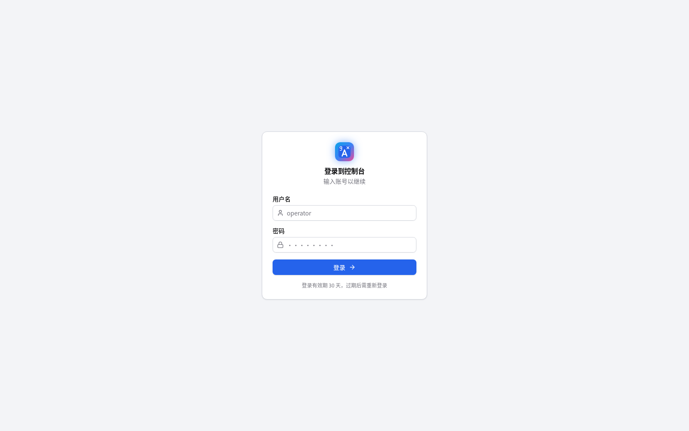

> 📌 **当前版本不提供账户功能**：没有用户注册、没有密码校验、没有角色权限。`server/app/auth.py` 的 `authenticate()` 接受任意非空的用户名和密码 —— **这是本版本的设计，不是临时替代方案**。
> 这个账号唯一的作用是拿一个 JWT，并把你记为**审计主体（是谁点的）**。
> 账户与权限体系不在本版本范围内，将来可能加入。填任何非空用户名都能正常使用全部功能。

两个概念别混（这是产品设计里最容易搞反的地方）：

| 概念 | 是什么 | 在哪选 |
|---|---|---|
| **登录账号** | 一个**人**（operator） | 登录时 |
| **发送方 Agent** | 这次动作以**哪个智能体**的名义发出 | 每次操作时在对话框里选 |

登录进去之后，右上角显示的就是你登录的名字。

---

## 5. 界面地图

登录后默认落在**系统状态**。左侧是 14 个入口，分四组：

| 分组 | 菜单 | 干什么 |
|---|---|---|
| **系统** | 系统状态 | 一眼看全局：主机、项目、计划、智能体、任务、会话 |
| | 快捷入口 | 你收藏的项目 / Agent / 会话 / 计划 |
| | 算力主机 | 机器资产清单 |
| **智能体管理** | 智能体 | 所有 Agent，派活、看统计 |
| | 会话 | Agent 的会话列表，看上下文水位 |
| | 任务 | 任务模板目录（一个 Agent 能干什么） |
| | 任务执行记录 | 每一次真实执行：谁派给谁、跑多久、成没成 |
| | 快捷指令 | 预置的常用指令，填几个参数就能发 |
| | 技能共享 | 全局技能库（"怎么做"的沉淀） |
| | 公告 / 工作日志 | Agent 写的公告与日志 |
| **项目管理** | 项目列表 | 项目 + 成员 |
| | 项目组模板 | 可复用的团队模板 |
| **计划** | 计划 | 多步计划及其推进情况 |

顶部还有几个常驻控件：

- **信息发送**（右上蓝色按钮）：全局发消息/派任务，任何页面都能用
- **页签栏**：打开过的页面留在上面，可以来回切
- **服务设置**：选择语音识别主机、看 MCP 通道状态（见 6.14）
- **全屏 / 主题（日/夜）/ 语言（中/英）/ 锁屏 / 用户菜单**

---

## 6. 逐页说明

### 6.1 系统状态

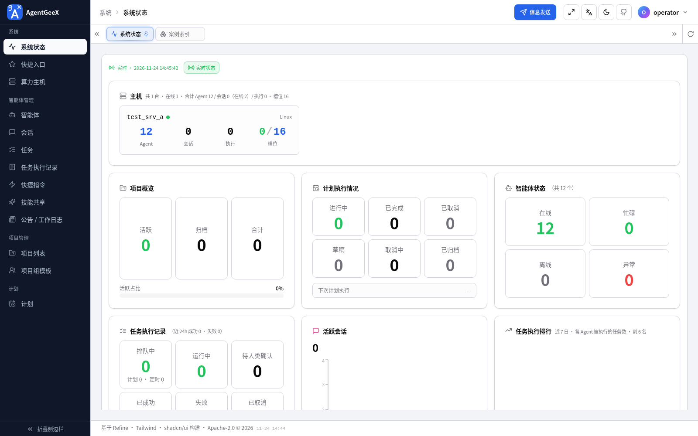

一屏回答"我这套系统现在什么状况"。

- **主机**：几台、几台在线、合计多少 Agent / 会话 / 执行 / 槽位。卡片上直接写 `test_srv_a` 这类主机名和它的操作系统。
- **项目概览**：活跃 / 归档 / 合计，下面一条活跃占比进度条。
- **计划执行情况**：进行中 / 已完成 / 已取消 / 草稿 / 取消中 / 已归档 + 下次计划执行时间。
- **智能体状态**：在线 / 忙碌 / 离线 / 异常四个数字。
- **任务执行记录（近 24h）**：排队中（计划 / 定时）/ 运行中 / 待人类确认 / 已成功 / 失败 / 已取消。
- **活跃会话**：当前在跑的会话数。
- **任务执行排行（近 7 日）**：每个 Agent 跑了多少任务，前 6 名柱状图。

> 右上角那个「实时」小标签说明这一页是**定时刷新**的，不用手动按 F5。

### 6.2 快捷入口

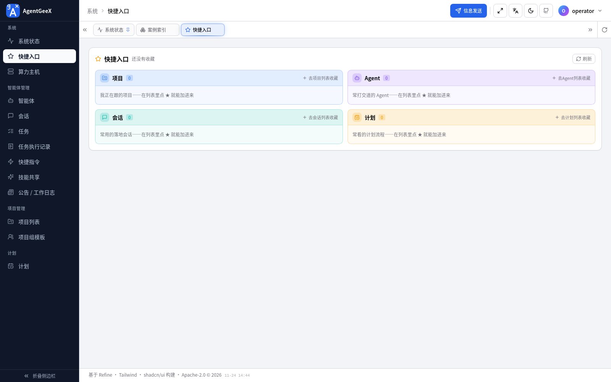

四个收藏夹：项目 / Agent / 会话 / 计划。

用法只有一句：**去对应列表页，点那一行的 ★，它就会出现在这里。**
每块右上角的「去 XX 列表收藏」就是直接跳过去。

### 6.3 算力主机

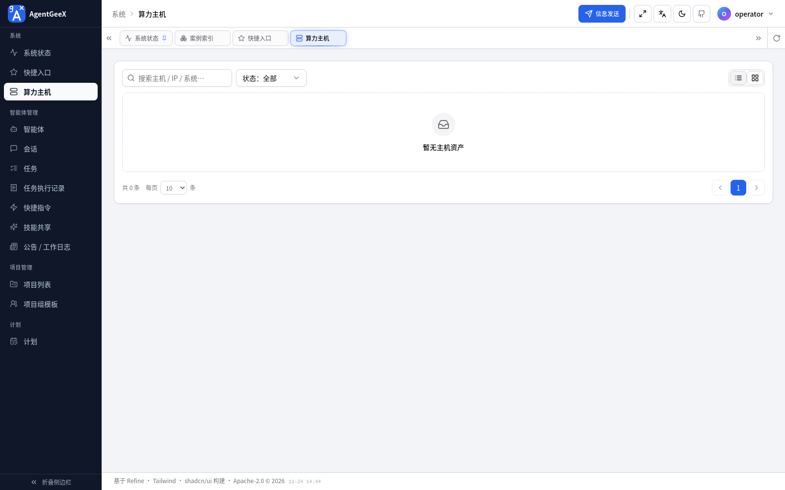

机器资产清单，来自内核的 `agx_host_inventory`。

每张卡/每行包含：主机名、别名、IP、SSH 端口、操作系统、并发槽位上限、当前占用、在线状态、心跳时间、该主机上有几个 Agent。

右上角可以在**卡片视图 / 表格视图**之间切换；点铅笔可以改别名、IP、SSH 端口、槽位上限等。

### 6.4 智能体

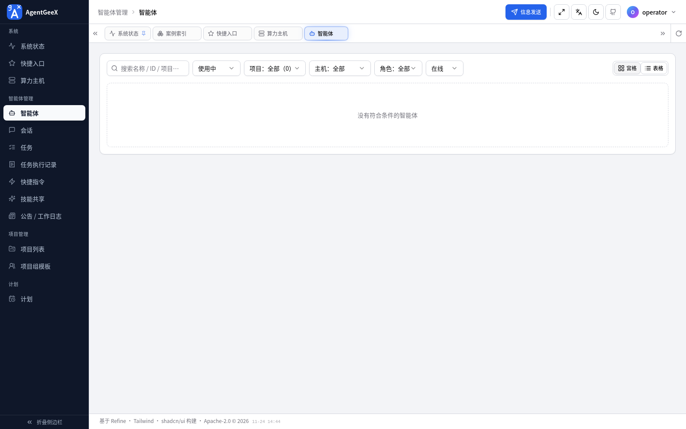

所有 Agent，按项目分组（上图是 `system` 项目下的 4 个已部署系统 Agent）。

顶部筛选：搜索框 / 使用中 / 项目 / 主机 / 角色 / 在线状态。右上角切**密格 / 表格**。

每张卡片上有：

- 名字 + **在线**徽标（绿点）
- 标签：`原生`（系统自带）、`已部署`（文件已落地）、岗位（项目经理 / 车间管理 / 主机管理 / Agent 管理 / worker…）
- 三个数字：**会话 / 任务 / 执行**（任务 = 它能干几类活；执行 = 实际跑过几次）
- **信息发送**：给它派活
- ★ 收藏、🕐 历史

> 模板型 Agent（还没部署的 worker）默认被「使用中」这个筛选挡住。想看全部，把「使用中」改成「全部」。

### 6.5 会话

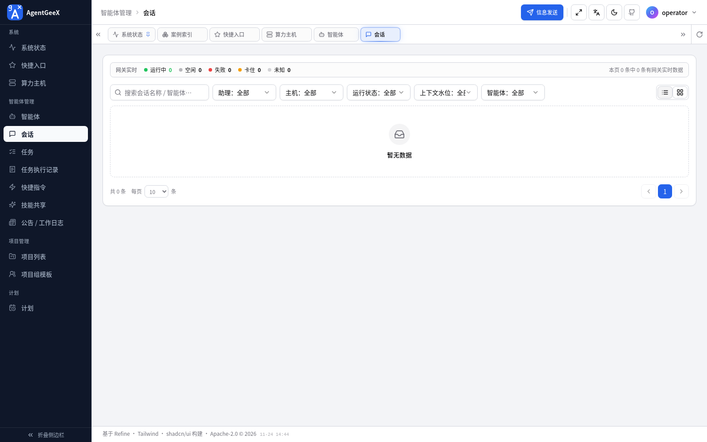

Agent 的会话列表。顶部一排实时统计：**运行中 / 空闲 / 失败 / 卡住 / 未知**。

每行：会话名称、所属智能体、运行状态、**上下文占比**（这条最有用 —— 超过 ~80% 该考虑 `/compact` 了）、消息数、最近活动、会话 ID。

行尾的「发消息」直接在这个会话里说话。

> 上下文占比是彩色的：低是蓝色，接近满会变红。**看到红的就清一下**，否则那个 Agent 下一轮可能因为上下文过大直接失败。

### 6.6 任务

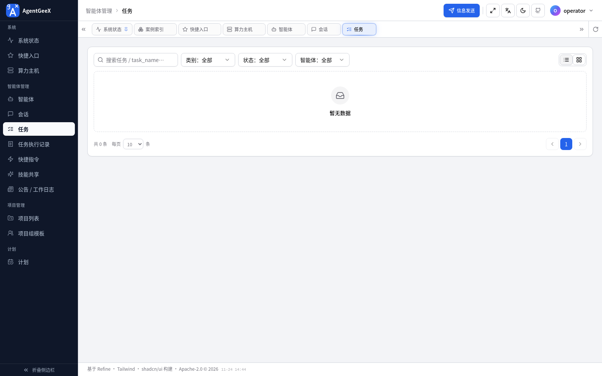

**任务模板目录** —— 一个 Agent "会干什么"的清单，不是执行记录。

列：任务（描述）/ `task_name`（稳定标识）/ 归属智能体 / 类别（`universal` / `general` / `watchdog_alert` / …）/ 可见性（共享 / 私有）/ 状态（启用 / 停用）/ 更新时间 / 编辑。

筛选：搜索 / 类别 / 状态 / 智能体。

> 为什么同一个名字出现好多次？因为模板是**按 Agent 一份**的 —— `universal` 每个 Agent 都有一条。上图 62 条就是这么来的。
>
> 任务文案本身是**随产品发布**的（来自 `agx_struct.json` 与 `tasks/*.md` 模板，装库时写入数据库），不是界面上的标签。
> 英文版手册里这一页仍然显示中文描述，因为截图取的是中文部署 —— 那是数据，不是漏翻的文案。要英文任务文案，需要改模板。

### 6.7 任务执行记录

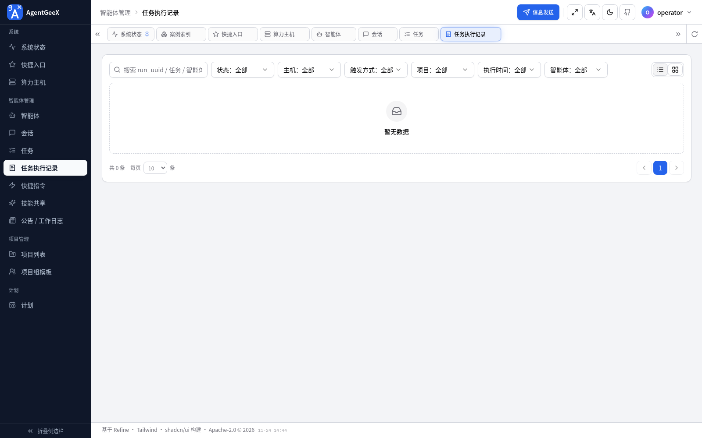

**每一次真实执行**都在这里，这是排查问题第一站。

列：`run_uuid` / 任务 / **发送方 → 接收方** / 会话 / 状态 / 开始·耗时 / 操作。

筛选很全：run_uuid、状态、主机、**触发方式**（人工 / 计划 / 唤醒…）、项目、执行时间、智能体。

点行尾铅笔展开详情：完整指令、结果、SUMMARY、事件时间线（什么时候派发、什么时候唤醒、什么时候签收）。

> 上图两条：一条 `已成功 65s`，一条 `运行中` —— 就是下面第 7 节那次演示留下的。

### 6.8 快捷指令

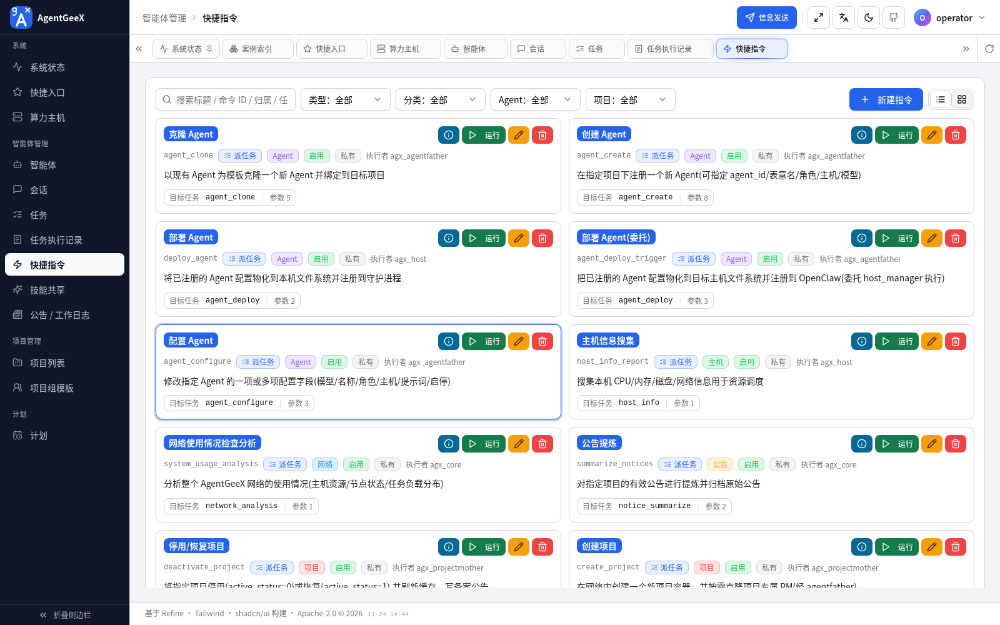

把常用操作做成卡片，**填几个参数就能发**，不用每次手打长指令。

每张卡：名字、逻辑 ID、类型标签（派任务 / Agent / 主机 / 网络 / 公告 / 项目）、启用状态、可见性、**执行者**（这条指令由哪个 Agent 执行）、参数个数。

按钮：▶ 运行 / ✏ 编辑 / 🗑 删除。右上角「+ 新建指令」。

典型内容：克隆 Agent、创建 Agent、部署 Agent、配置 Agent、主机信息搜集、网络使用情况检查、公告提炼、创建项目、停用项目…

### 6.9 技能共享

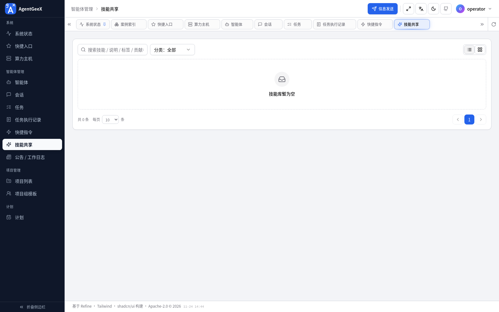

全局技能库。技能 = **可复用、能照着做的"怎么做"**（命令、踩坑、示例），与"公告"分工明确：

| | 放什么 |
|---|---|
| **技能共享** | "这个坑怎么绕过" —— 读了能照做 |
| **公告** | "我今天干了什么" —— 读了知道发生过什么 |

搜索框支持名字 / 说明 / 标签 / 贡献者；可按分类过滤。新装的系统这里是空的，用得越久越有价值（热门技能会自动浮上来）。

### 6.10 公告 / 工作日志

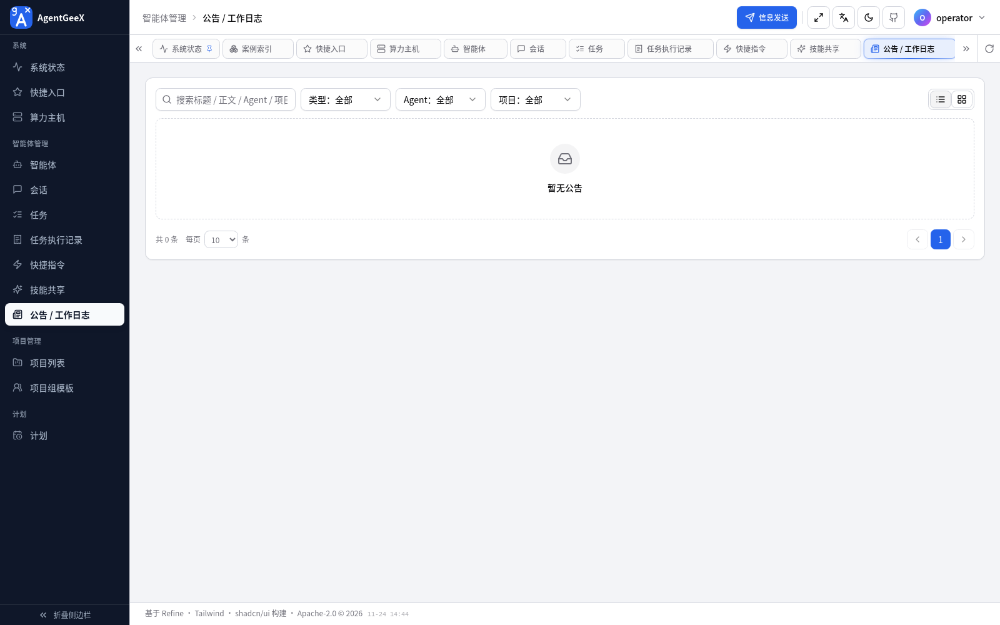

Agent 写下的公告：工作日志、决策记录、踩坑、交接、配置变更。可按类型、可见性、项目、Agent、任务追溯筛选。

### 6.11 项目列表

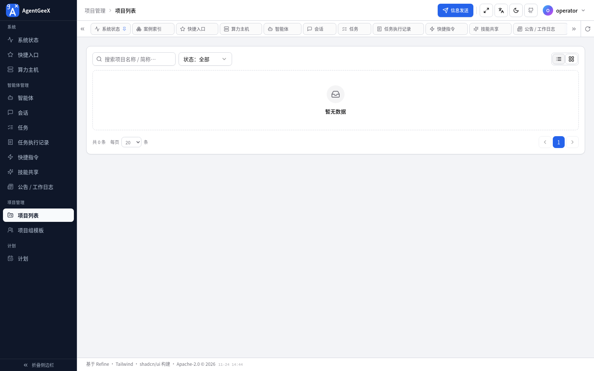

项目是所有任务、Agent、算力的容器。每行：项目名、简称、**项目组成员**（一排标签，一眼看出这个项目有谁）、状态、创建时间。

新装的系统只有 `system` 一个项目，里面是 12 个系统级 Agent（`agx_core` / `agx_agentfather` / `agx_projectmother` / `agx_host_<你的主机>` / `super_pm` / 各类 worker 模板）。

### 6.12 项目组模板

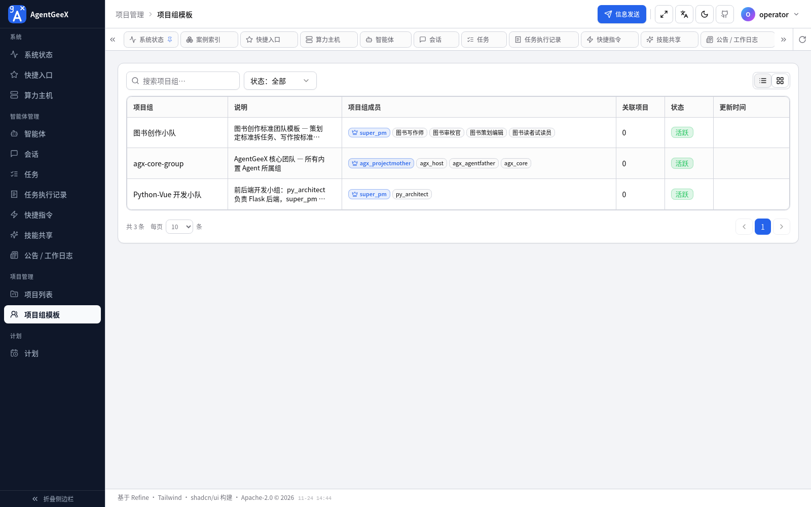

可复用的团队模板：把一组 Agent 打包，绑到一个新项目上就一次性克隆出整套班子。

列：项目组 / 说明 / 项目组成员 / 关联项目 / 状态 / 更新时间。

系统自带三个：`agx-core-group`、`Python-Vue 开发小队`、`图书创作小队`。

### 6.13 计划

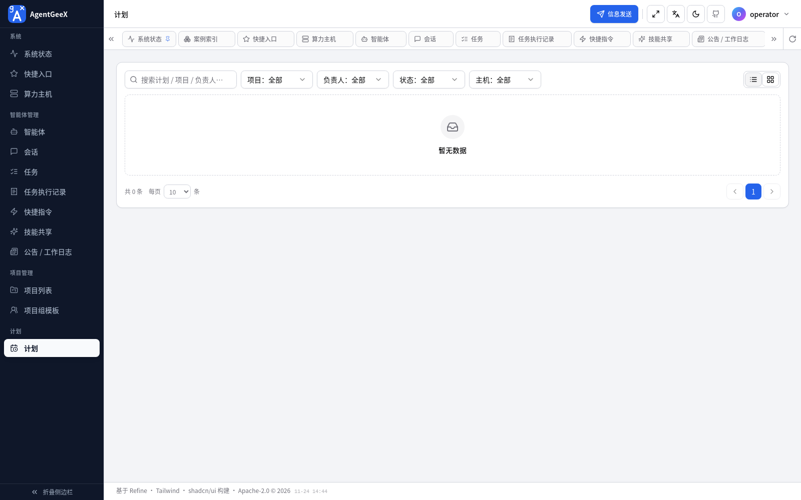

多步计划及其推进情况。筛选：计划 / 负责人 / 状态 / 主机。

点进去能看到每一步的状态、前置依赖、是串行还是并行（扇出/扇入）。

> 空的是正常的 —— 新装的系统还没有跑过计划。用「快捷指令」里的 `plan_generate_and_deploy` 可以生成第一个。

---

### 6.14 服务设置

顶部右侧的「服务设置」打开一个**窗口**（不在左侧菜单里），两个标签页。

**语音服务** —— 语音识别主机的选择与检测：

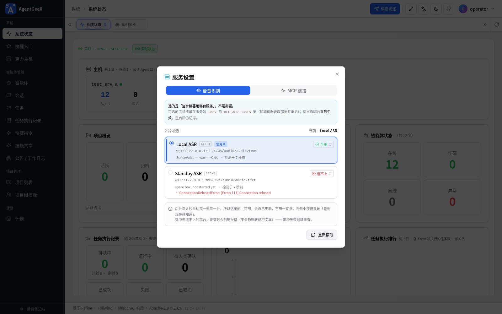

- 列表来自服务端 `.env` 的 `BFF_ASR_HOSTS`。每行：名称、WebSocket 地址、备注、可用状态（可用 / 不可用 / 未测试）、最近一次探测时间。
- 选中某一台 → **立即切换**，并马上探测一次；偏好存在 `webtools/server/.runtime/service_settings.json`，重启后保持。
- 每行的「检测」按钮 = 手动探一次（一次 WebSocket 握手的成本）。
- 状态由服务端后台每 8 秒探活维护。所以「服务回来了」是系统先发现的，不用人等一次失败再刷新页面。

**MCP 连接** —— 内核通道：网关地址、工具数量、连通状态。

> 这一页解决的是一件事：**语音服务可以装在很多台机器上，这里决定用哪一台。**
> 改「有哪些可选」要动 `.env` 并重启 BFF；改「这次用哪台」在这个窗口点一下，立刻生效。详见第 8 章。

---

## 7. 走一遍完整流程：派一个任务

这是最常用的一条路。做完这一遍，你就理解了整个系统。

### 第 1 步：找到要派活的 Agent

进 **智能体**，点目标 Agent 卡片上的 **信息发送**（或者用右上角全局的「信息发送」按钮）。

### 第 2 步：选任务模板、写指令

对话框里需要三样：

| 项 | 填什么 |
|---|---|
| 接收方会话 | 默认主会话即可（`agent:<名字>:main`） |
| 任务模板 | 这次用哪类活。临时的事选 `universal` |
| 指令 | 用自然语言写清楚要它干什么 |

写指令的一个要点：**说清"要什么产出 + 不要做什么"**。例如：

```
请用一句话报告本机的 CPU 核数与内存总量，不要做其他事。
```

### 第 3 步：看它跑

派出去之后立刻能在 **任务执行记录** 看到一条 `运行中`：


状态会自己变：`运行中` → `已成功`（或 `失败`）。上图那条成功的用了 65 秒。

### 第 4 步：看结果

点开那条记录的铅笔，能看到完整指令、执行者的 SUMMARY、以及事件时间线。

示例结果：

> 本机 CPU 4 核，内存总量 8016384 kB（约 7.6 GiB / 8 GB）。

### 第 5 步：看会话

回到 **会话**，会看到那个 Agent 的会话从"无"变成一条记录，里面有你这次的两条消息，还有**上下文占比**：


---

## 8. 语音输入（语音转文字）

### 8.1 在哪用


信息发送对话框里，输入框旁边的麦克风按钮。点一下开始录，再点停止；到 **60 秒自动停**（忘了停不会一直录下去）。

几条写死的行为：

| 行为 | 为什么 |
|---|---|
| 录音中、识别中**都不能发送** | 避免把半句话发出去 |
| 识别结果**追加**在输入框末尾，不覆盖 | 你可能已经打了字，覆盖是最不能接受的失败 |
| 失败会区分四种原因：没有权限 / 没有设备 / 服务没开 / 超时 | 这四件事要做的事完全不同 |
| 录音时有波形 | 最常见的两个故障是「系统静音」和「忘了停」，症状都是「我说了半天怎么没字」；波形在动就说明声音真进去了 |

### 8.2 一条链路

```
浏览器麦克风
   │  POST /v1/audio/transcribe   （Bearer token）
   ▼
BFF  :8090
   │  WS  ws://<语音主机>:<端口>/ws/audio/audio2text/{client_id}
   ▼
语音服务（ASR）  →  返回文字
```

**为什么不让浏览器直连语音服务**，三条：

1. 地址会漏进前端包，换机器就得重新打包；商用场景里客户在远端，`127.0.0.1` 根本不存在。
2. 绕过鉴权 —— `/v1/*` 全要 Bearer token，直连语音服务没有任何门。
3. 出错说不清是谁的问题（连不上 / 超时 / 模型没加载，只能在浏览器里猜）。

所以 **BFF 是唯一前门**，语音地址只存在于服务端 `.env`，前端永远只知道 `/v1/audio/transcribe`。

### 8.3 配置分两处（这是最容易混的地方）

| 配在哪 | 存的是什么 | 谁能改 | 要重启吗 |
|---|---|---|---|
| `webtools/server/.env` 的 `BFF_ASR_HOSTS` | **有哪些可选**（部署事实） | 运维 / 部署的人 | 要：`./start.sh restart` |
| 服务设置窗口里选的 | **这次用哪台**（运行偏好） | 任何登录用户点一下 | 不要 |

一句话：**清单是事实，选择是偏好。**

`.env` 的写法（JSON 数组）：

```bash
BFF_ASR_HOSTS=[{"id":"asr-a","name":"Local ASR","url":"ws://127.0.0.1:9998/ws/audio/audio2text","note":"本机 · CPU"},{"id":"asr-b","name":"GPU box","url":"ws://10.0.0.21:18888/ws/audio/audio2text","note":"局域网 · 独立显卡"}]

# 只在上面为空时兜底（单机部署可以只配这条）
BFF_ASR_WS_URL=ws://127.0.0.1:9998/ws/audio/audio2text

BFF_ASR_TIMEOUT=30          # 冷启动要加载模型（约 10s），30s 让热态和冷态都容得下
BFF_ASR_HEALTH_INTERVAL=8   # 后台探活间隔（秒）
```

三个要点：

- `url` **必须写到 `audio2text` 结尾**，后面的 `client_id` 由 BFF 每次拼接。
- `id` 是「选了哪台」的唯一依据。**改了 `id` 等于换了一台机器**，之前的选择会失效、回到第一台。
- 配错（坏 JSON / 缺 `url` / `id` 重复）**不会让 BFF 起不来** —— 会退回单机默认并记一条 warning。语音是辅助功能，写错它不该把整套服务拖死。

### 8.4 起一个语音服务

仓库里带两个实现，选一个装：

| 实现 | 引擎 | 算力 | 怎么起 |
|---|---|---|---|
| `tools/audio_stt/audio_service_server.py` | SenseVoiceSmall（funasr）+ VAD | 轻，CPU 可用，模型首次自动下载 | `python tools/audio_stt/audio_service_server.py --host 0.0.0.0 --port 9998` |
| `tools/audio_stt/audio_service_server_qwen_asr.py` | Qwen3-ASR-1.7B | 权重约 4.7 GB，建议 GPU | `./tools/audio_stt/start_qwen_asr.sh start` |

Qwen 这条先做**环境自检**（只查不启动）：

```bash
./tools/audio_stt/start_qwen_asr.sh check
```

它会逐项告诉你缺什么、怎么补。四个必查项，也是四个真实的坑：

| 检查项 | 不满足会怎样 |
|---|---|
| 解释器能 `import qwen_asr` | 直接起不来 |
| `torch` 版本（建议钉 2.7.0） | `torch.cuda.is_available()` 为 False，静默退回 CPU，慢几十倍 |
| 装了 `websockets` | uvicorn 会**静默降级成纯 HTTP**，所有 WebSocket 请求 404 —— 最难查的一个 |
| 模型目录有 `config.json` + `*.safetensors` | 起不来（下载没完成也是这个症状） |

修齐了再 `start`。脚本还带 `stop` / `restart` / `status` / `log` / `run`（前台运行，给 pm2 / systemd 用）：

```bash
pm2 start ./tools/audio_stt/start_qwen_asr.sh --name qwen-asr -- run
pm2 save
```

**端口**：同一套 BFF 里要并存「本机 + 远端」两台，端口必须分开（例如本机 9998、远端 18888）。只有一台的话随便。

### 8.5 怎么确认它真的能用

三层都验过才算通，别跳步：

**第一层，服务自己活着**

```bash
./tools/audio_stt/start_qwen_asr.sh status     # 或
curl -s http://127.0.0.1:9998/
```

**第二层，BFF 探得到它**

服务设置窗口里那台显示「可用」，或者直接问题接口：

```bash
curl -s -H "Authorization: Bearer $TOKEN" http://127.0.0.1:8090/v1/settings/asr
```

看每个 `hosts[].state` 是 `up` 还是 `down`，`error` 里会写具体原因（例如 `ConnectionRefusedError`）。

**第三层，真的能识别**

```bash
curl -s -X POST http://127.0.0.1:8090/v1/audio/transcribe \
     -H "Authorization: Bearer $TOKEN" \
     -H "Content-Type: audio/wav" \
     --data-binary @test.wav

→ {"text":"本机CPU4核内存8G。","engine":"sensevoice","host_id":"asr-a","attempts":1,"duration_ms":8256}
```

返回里带 `engine` 和 `host_id` —— **这次是谁干的活，一眼看得出来**，不用去翻日志。上面这条是实测输出（冷启动含模型加载，8.2 秒；热态通常 1 秒内）。

### 8.6 排错

| 症状 | 真正原因 | 怎么办 |
|---|---|---|
| 点麦克风没反应，提示没权限 | 浏览器没给麦克风授权 | 地址栏左侧站点设置里放开。**注意：`http://` 且非 localhost 时，浏览器直接禁用麦克风**，必须 https 或 localhost |
| 一直转圈然后超时 | 服务在，但模型没加载完（冷启动） | 调大 `BFF_ASR_TIMEOUT`；或先手动识别一次预热 |
| 提示「服务不可用」 | BFF 探活失败 | 查 `url` 对不对、端口通不通。**换机器忘了改 `.env`** 是最常见的 |
| 服务日志里 WS 请求全 404 | 没装 `websockets`，uvicorn 降级成纯 HTTP | 装上 `websockets` 重启服务 |
| 识别结果为空 | 音频没人声 / 系统静音 | 看录音时的波形有没有动 |
| 返回 `ERROR: ...` 之后连接不结束 | 语音服务的错误帧不带结束标记 | 这是 ASR 服务的既有行为，BFF 靠 30s 超时兜底；同时去查服务日志 |

> ⚠️ **HTTPS 那条最容易漏**：浏览器只在 `https://` 或 `localhost` 下给麦克风权限。你用 `http://192.168.0.x:5190` 打开控制台，麦克风会被浏览器直接禁掉 —— 这跟 BFF、跟语音服务都没关系，别去查错地方。

---

## 9. 常见问题

### 页面能打开，但所有列表都是空的

99% 是 **BFF 读不到内核数据**。按顺序查：

1. **`/readyz`**：`curl -s http://127.0.0.1:8090/readyz`
   正常应该长这样：
   ```json
   {"status":"ok","kernel":{"mcp_sse":true,"tool_count":96,"mysql":true,"redis":true}}
   ```
   `mcp_sse: false` → MCP 网关不通，先看第 2 条。
2. **MCP 网关**：`curl -s http://127.0.0.1:31890/agentgeex/mcp` 有没有响应。没有就去 `./mcp.sh start`。
3. **`network_id` 对不对**：这是**最容易踩的坑**。BFF 早期把网络号写死成 `lan_001`，如果你的 `agx_config.json` 里 `network_id` 不是它，所有 `WHERE network_id = ?` 都查不到东西 —— 界面全空，但系统状态页却正常（那一页走的是另一条查询）。已修为读配置，老版本遇到就是这个症状。

### `/readyz` 一直超时，日志里刷 `mcp session lost ... cannot import name 'streamablehttp_client'`

Python 包 `mcp` 在 1.28 版本把 `streamablehttp_client` 改名成了 `streamable_http_client`，BFF 老代码 import 不到 → 连不上 MCP → `/readyz` 卡死。

已修（两个名字都兼容）。如果你的版本还报这个，升级代码，或把 `mcp` 钉到 1.27.0。

### 派了任务，一直是"运行中"但 `started_at` 是空

任务**已经发出去但对方没开工**。查 `~/.agx/logs/ws_client.log`：

- 看到 `no such table: session_key_contract` 之类 → openclaw 的状态库 schema 不对，跑一次 `openclaw doctor --fix` 后重启网关。
- 看到 `会话不存在，自动创建` 但之后没动静 → 那个 Agent 在 openclaw 里没注册/没部署。
- 什么都没有 → 守护进程没在跑，`~/.agx/daemon.sh status`。

### 前端起不来，日志里 `nohup: 无法运行命令 'npm'`

非交互 shell 里没有 node。先 `export PATH=<你的 node bin>:$PATH` 再跑 `./start.sh start`。

### 换台机器访问，页面能开但没数据

前端默认把 API 地址写死成 `http://127.0.0.1:8090`。你用**另一台电脑**的浏览器访问 `http://<服务器IP>:5190` 时，浏览器会去连**你自己那台机器**的 8090，当然不通。

两个解法：
- 在服务器上跑前端时指定：`VITE_API_URL=http://<服务器IP>:8090/v1 npm run dev`
- 或者干脆在服务器本机用浏览器/远程桌面看。

---

## 10. 停止与重装

```bash
cd ~/.agx/webtools
./start.sh stop            # 停 BFF + 前端（MCP 归 PM2，脚本不碰）
pm2 stop agx-mcp-gateway   # 真要停 MCP 才用这条
```

**整机重装**（想推倒重来）：

```bash
cd <源码目录>
python3 install.py --uninstall   # 删 Agent + 清库
```

⚠️ **实测注意**：`--uninstall` 目前只删 gateway 里的 Agent 记录，**不删** `~/.openclaw/agents/<id>/` 目录，也**不会**自动往下清安装目录（会问确认）。手动重装前建议补一刀：

```bash
rm -rf ~/.openclaw/agents/agx_*      # 残留目录
```

否则重装时 `install.py` 会从 gateway 里**复用**上一次的 Agent ID —— 你会看到新机器上冒出旧的机器名。

> 另外记住一条：**一台机器上装第二套实例**时（不同 `--workdir`），必须显式指定配置文件，否则它会去读默认那份：
>
> ```bash
> AGX_CONFIG_PATH=~/.agx_demo/agx_config.json \
> AGX_CREDS_ENV=~/.agx_demo/agx_creds.env \
> python3 install.py --core --workdir ~/.agx_demo
> ```

---

## 附：这套界面是怎么拼出来的

| 层 | 技术 |
|---|---|
| 前端 | React + Refine + Tailwind + shadcn/ui，Vite 构建，中英双语 |
| BFF | FastAPI + uvicorn，JWT（HS256，零第三方依赖的实现） |
| 内核通道 | MCP over streamable-http |
| 数据 | MySQL（真源）+ Redis（缓存） |

界面上的每个列表都对应 BFF 一个 `GET /v1/<资源>`，每次请求都带着登录用户的 JWT；BFF 校验后以固定身份（`agx_core`）向内核取数。

---

*许可：Apache-2.0。本手册配图来自真实安装的测试机，不含任何真实生产主机名。*
